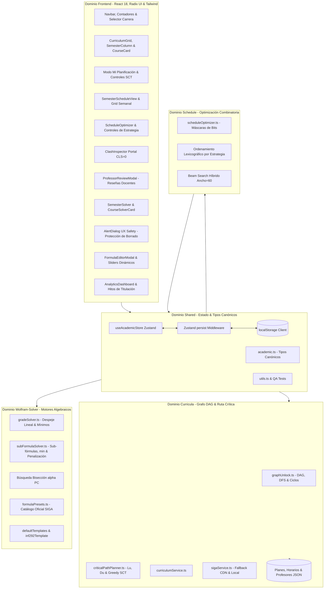
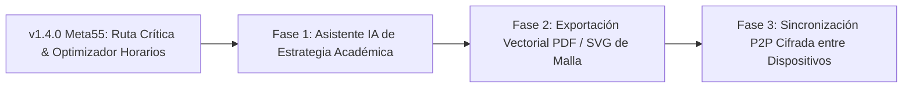

# Meta55 — USM Malla, Horario SIGA & Grade Solver — Memoria Técnica y Documentación Maestra (CONTEXT.md)

> 🌐 **Sitio Web Oficial:** [https://meta55-dev.github.io/Malla-USM/](https://meta55-dev.github.io/Malla-USM/)  
> 👨‍💻 **Autores y Desarrolladores:**
> - **Joaquín D. Barrios** — GitHub: [@Jota216](https://github.com/Jota216)
> - **Jose Astudillo** — GitHub: [@jastudilloi](https://github.com/jastudilloi)

Este documento constituye la memoria viva, especificación funcional y guía arquitectónica del repositorio **Meta55** (`Meta55 — USM Malla, Horario SIGA & Grade Solver`, anteriormente conocido bajo el nombre preliminar *SansanoTracker*). Define las decisiones de diseño, modelos matemáticos, algoritmos de optimización, flujos de estado y evolución histórica del proyecto.

---

## 1. Idea General del Proyecto

**Meta55** es una plataforma web de página única (**SPA - Single Page Application**), 100% de ejecución del lado del cliente (*client-side only*), diseñada específicamente para la comunidad estudiantil de la **Universidad Técnica Federico Santa María (USM)** en todas sus sedes y carreras (Casa Central Valparaíso, San Joaquín, Vitacura, Viña del Mar y Concepción).

### 1.1 Principios Fundamentales
* **Ejecución 100% Estática y Descentralizada:** No depende de un backend propietario ni almacena datos en bases de datos remotas no autorizadas. El despliegue se realiza directamente sobre **GitHub Pages**.
* **Privacidad y Persistencia Local:** Todo el avance académico, notas parciales, planificaciones futuras, selecciones horarias e hitos de titulación residen exclusivamente en el navegador del usuario a través de la API `localStorage`. Dispone de importación y exportación de respaldos en formato JSON estructurado.
* **Ergonomía Sansana y Fidelidad Reglamentaria:** La interfaz, terminología, ponderaciones y escalas de evaluación responden a los reglamentos y dinámicas académicas reales de la USM (siglas institucionales, certámenes, controles, laboratorios, créditos SCT vs USM, regla de penalización por mínimos de bloque y nota de aprobación 55: la *Meta 55*).

### 1.2 Capacidades del Sistema y Flujo de Trabajo

```mermaid
flowchart TD
    Estudiante[Estudiante Sansano] --> MallaModule[1. Malla Curricular & Mi Planificación DAG]
    Estudiante --> ScheduleModule[2. Horario Semestral & Optimizador SIGA]
    Estudiante --> SolverModule[3. Meta 55 - Grade Solver & Simulador]

    subgraph MallaModule [Malla Curricular & Planificador DAG]
        M1[Visualización Semestre a Semestre 1 al 11+]
        M2[Desbloqueo Reactivo de Prerrequisitos en DAG]
        M3[Modo Mi Planificación: Arrastre y Semestres Extra]
        M4[Algoritmo de Ruta Crítica Lu y Desbloqueo Du]
        M5[Planificador Rápido Greedy sujeto a Tope SCT]
        M1 --> M2 --> M3 --> M4 --> M5
    end

    subgraph ScheduleModule [Horario Semestral & Optimizador Multi-Criterio]
        H1[Catálogo de Ramos, Paralelos, Salas y Cupos SIGA]
        H2[Evaluación de Topes de Horario por Máscara de Bits]
        H3[Optimizador: Minimizar Topes, Minimizar Ventanas, Maximizar Tiempo Libre]
        H4[Búsqueda Exhaustiva o Beam Search en menos de 50ms]
        H5[Ficha Docente Psicopedagógica y Exportación .ics]
        H1 --> H2 --> H3 --> H4 --> H5
    end

    subgraph SolverModule [Calculadora Solver & Simulador de Notas]
        S1[Despeje Algebraico Lineal NF mayor o igual a 55]
        S2[Sub-Fórmulas Encadenadas: PCE, PC, PP con Descarte min]
        S3[Muerte Súbita y Regla Oficial de Penalización USM]
        S4[Fórmulas por Tramos alpha PC y Simulador de Examen Global]
        S5[UX Safety: Modal de Confirmación Destructiva AlertDialog]
        S1 --> S2 --> S3 --> S4 --> S5
    end
```



1. **Malla Curricular Interactiva y Modo "Mi Planificación" (Grafo DAG):**
   * Representación formal de la malla curricular multi-carrera (incluyendo Informática Plan 2014, Plan 2024 y catálogo multi-sede USM).
   * Clasificación reactiva del estado de cada asignatura: `APPROVED`, `IN_PROGRESS`, `AVAILABLE`, `LOCKED`.
   * **Modo "Mi Planificación":** Permite al estudiante proyectar sus semestres futuros mediante **Drag & Drop interactivo libre**, reordenando asignaturas y extendiendo la carrera a 12, 13 o más semestres. El sistema incorpora un validador reactivo no restrictivo que despliega una **alerta destacada en la parte superior** ante cualquier combinación imposible de prerrequisitos, junto con un botón de resolución automática en cascada y una insignia sutil de conflicto en cada tarjeta afectada.
   * **Algoritmo de Ruta Crítica:** Identifica los cuellos de botella formativos mediante la longitud del camino crítico pendiente ($L_u$) y el conteo de descendientes transitivos ($D_u$), etiquetando ramos con insignias `Crítico` o `Clave` con un retardo de 1.5 segundos (`1500ms`) en sus popouts descriptivos para evitar cualquier intromisión visual al mover el cursor. Un auto-planificador voraz programa el camino de egreso más rápido posible respetando el límite máximo de créditos SCT configurado por el estudiante.

2. **Planificador y Optimizador de Horarios Semanales SIGA:**
   * Integración de datos reales de oferta académica: paralelos, campus, profesores, salas y cupos.
   * **Motor de Optimización Multi-Criterio:** Evalúa el espacio de combinaciones de paralelos aplicando máscaras de bits para optimizar bajo 3 estrategias prioritarias:
     1. *Minimizar Topes*: Elimina solapamientos de clases en el mismo bloque horario.
     2. *Minimizar Ventanas*: Compacta el horario agrupando bloques contiguos y eliminando tiempos muertos.
     3. *Maximizar Tiempo Libre*: Concéntrica las actividades para generar días completos o mañanas/tardes despejadas.
   * Búsqueda híbrida determinista con *Beam Search* cuando el espacio supera 5.000 combinaciones (tiempo de respuesta inferior a 50 ms).
   * **Interfaz de Diagnóstico de Topes sin Reflujo (On-Demand Clash Inspector):** Las colisiones horarias se resumen mediante un contador numérico compacto de altura fija (`h-8`: `0 Topes` o `N Topes`) y su desglose detallado se renderiza exclusivamente bajo demanda (clic del usuario) a través de una capa superpuesta (*Portal* de Radix UI Popover), garantizando estabilidad visual total (`Zero Cumulative Layout Shift / CLS = 0`) durante la selección de paralelos y la auto-optimización.
   * Previsualización instantánea con estabilidad dimensional garantizada (contenedor estático de altura mínima reservada `min-h-[44px]`, CLS = 0, sin temblores ni bucles de hover).
   * Reseñas psicopedagógicas de profesores y exportación directa de la agenda a formato `.ics` para calendarios externos.
   * Interfaz sobria y profesional: erradicación total de emojis en favor de tipografía concisa e iconografía vectorial SVG de Lucide.

3. **Calculadora y Solucionador de Notas ("Meta 55 - Grade Solver"):**
   * Deducción analítica inversa de notas necesarias en evaluaciones pendientes para alcanzar la nota mínima institucional ($NF \ge 55$).
   * Modelado de sub-fórmulas compuestas ($PCE$, $PC$, $PP$) con pesos globales e intra-bloque.
   * Tratamiento matemático de descarte de peores notas (operador $\min$) frecuente en controles y tareas.
   * Detección de restricciones no negociables de bloque (*sudden-death*) y regla de penalización oficial USM ($NF = \min(\dots)$).
   * Fórmulas paramétricas por tramos con peso variable $\alpha(PC)$ y simulador interactivo de examen global / recuperativo (modalidades Matemática 70/30, Física 60/40 y reemplazo de peor certamen).
   * **UX Safety:** Salvaguarda modal de confirmación destructiva antes de desinscribir una asignatura para evitar la pérdida accidental de notas y ponderaciones personalizadas.

---

## 2. Arquitectura y Stack Tecnológico

El proyecto sigue una arquitectura desacoplada y orientada a tipos, estructurada en dominios modulares independientes: interfaz de usuario (`frontend/`), resolución de notas y restricciones algebraicas (`wolfram-solver/`), planes de estudio, ruta crítica y grafos curriculares (`curricula/`), optimización combinatoria de horarios (`schedule/`), y estado y utilidades transversales (`shared/`).



### 2.1 Especificaciones Técnicas

| Área | Tecnología | Versión / Detalle | Justificación |
|---|---|---|---|
| **Frontend Framework** | **React** | `^18.3.1` | Manejo reactivo de componentes, hooks modernos (`useMemo`, `useCallback`) y alta velocidad de renderizado. |
| **Lenguaje** | **TypeScript** | `^5.6.3` | Tipado estricto extremo (`strict: true`), seguridad en contratos de datos y eliminación total de fallos en tiempo de ejecución. |
| **Bundler & Tooling** | **Vite** | `^5.4.10` | Inicio instantáneo en desarrollo (HMR impulsado por ESM nativo) y compilación optimizada con Rollup. |
| **Estilos & CSS** | **Tailwind CSS** | `^3.4.14` | Utilidades utilitarias de alto rendimiento, sistema de tokens semánticos corporativos USM y diseño *mobile-first*. |
| **Sistema de Componentes** | **shadcn/ui + Radix UI** | Primitivas accesibles | Componentes desacoplados, accesibles (ARIA) sin ataduras a librerías propietarias (`AlertDialog`, `Dialog`, `Dropdown`, etc.). |
| **Modo Oscuro** | CSS Variables + Tailwind | Nativo `zinc-950` / `slate-950` | Modo oscuro predeterminado de alto contraste, descansado para sesiones nocturnas de estudio. |
| **Gestión de Estado** | **Zustand** | `^4.5.5` | Almacén unificado, reactivo y ligero (<2KB) sin boilerplate de Redux, con middleware `persist`. |
| **Motor Matemático** | Módulos TypeScript puros | Funciones deterministas | Cero efectos secundarios; facilita pruebas unitarias aisladas y garantiza exactitud milimétrica de cálculo. |
| **CI/CD & Hosting** | **GitHub Actions + Pages** | Action `actions/deploy-pages@v4` | Despliegue continuo automático a la rama `gh-pages` con cada push a `main`. |

---

## 3. Estructura de Carpetas del Proyecto

```text
Malla_USM/
├── .github/
│   └── workflows/
│       ├── deploy.yml                      # Pipeline CI/CD automático para GitHub Pages
│       └── sync-data.yml                   # Sincronización periódica de datos upstream SIGA
├── docs/
│   └── SIGA_SCRAPER_ARCHITECTURE.md        # Arquitectura del scraper de SIGA USM y endpoints JSP
├── public/                                 # Recursos estáticos servidos directamente
│   └── data/                               # Datasets JSON de carreras, horarios, programas y profesores
├── scripts/                                # Automatización y sincronización de datos
│   ├── extract-siga-formulas.mjs           # Extractor multi-patrón de fórmulas desde PDFs oficiales
│   ├── sync-upstream-data.mjs              # Sincronizador de catálogos JSON upstream
│   └── siga-scraper/                       # Motor autónomo de extracción SIGA en Python
│       ├── generar.py                      # Scraper autónomo de datos de asignaturas y horarios
│       └── requirements.txt
├── src/
│   ├── curricula/                          # Dominio curricular, planes de estudio y grafos
│   │   ├── careers/
│   │   │   └── ici-2014.json               # Malla oficial 7313 (Civil Informática Plan 2014)
│   │   ├── planner/
│   │   │   └── criticalPathPlanner.ts      # Algoritmo de ruta crítica (Lu, Du) y planificación greedy SCT
│   │   ├── prerequisites/
│   │   │   └── graphUnlock.ts              # Algoritmos de grafos (DAG, detección de ciclos, BFS/DFS)
│   │   ├── services/
│   │   │   ├── curriculumService.ts        # Proveedor de planes de estudio y créditos
│   │   │   └── sigaService.ts              # Abstracción y carga de catálogos SIGA USM con fallback CDN
│   │   ├── tests/
│   │   │   └── criticalPathPlanner.test.ts # Suite de pruebas del planificador de ruta crítica
│   │   └── index.ts                        # Punto de exportación pública del dominio curricula
│   ├── frontend/                           # Dominio de presentación e interfaz de usuario React
│   │   ├── components/
│   │   │   ├── analytics/
│   │   │   │   └── AnalyticsDashboard.tsx  # Métricas de titulación, GPA, avance SCT e hitos
│   │   │   ├── curriculum/
│   │   │   │   ├── CourseCard.tsx          # Tarjeta interactiva de asignatura con estados y badges
│   │   │   │   ├── CourseDetailModal.tsx   # Modal de inspección profunda y dependencias del ramo
│   │   │   │   ├── CurriculumGrid.tsx      # Grilla horizontal/vertical con soporte de planificación
│   │   │   │   └── SemesterColumn.tsx      # Contenedor de asignaturas por semestre y controles
│   │   │   ├── layout/
│   │   │   │   ├── DataBackupModal.tsx     # Modal de exportación/importación de JSON
│   │   │   │   ├── Footer.tsx              # Pie institucional con enlaces y créditos a autores
│   │   │   │   └── Navbar.tsx              # Navegación principal, contadores, selector de carrera y plan
│   │   │   ├── schedule/
│   │   │   │   ├── ProfessorReviewModal.tsx# Ficha docente con 7 métricas psicopedagógicas
│   │   │   │   ├── scheduleOptimizer.ts    # Motor combinatorio multi-criterio y beam search de horarios
│   │   │   │   ├── SemesterScheduleView.tsx# Planificador interactivo de horario y exportación .ics
│   │   │   │   └── tests/
│   │   │   │       └── scheduleOptimizer.test.ts # Pruebas unitarias de ventanas, colisiones y beam search
│   │   │   ├── solver/
│   │   │   │   ├── CourseSolverCard.tsx    # Tarjeta modular con confirmación destructiva y simulador
│   │   │   │   ├── EnrollCourseModal.tsx   # Modal de inscripción rápida de asignaturas
│   │   │   │   ├── FormulaEditorModal.tsx  # Modal de configuración interactiva de fórmula y bonos
│   │   │   │   └── SemesterSolver.tsx      # Orquestador del semestre y metas de aprobación
│   │   │   └── ui/                         # Primitivas modulares Radix / shadcn/ui
│   │   │       ├── alert.tsx
│   │   │       ├── alert-dialog.tsx        # Primitiva modal de confirmación destructiva (UX Safety)
│   │   │       ├── badge.tsx
│   │   │       ├── button.tsx
│   │   │       ├── card.tsx
│   │   │       ├── checkbox.tsx
│   │   │       ├── command.tsx
│   │   │       ├── dialog.tsx
│   │   │       ├── dropdown-menu.tsx
│   │   │       ├── input.tsx
│   │   │       ├── label.tsx
│   │   │       ├── popover.tsx
│   │   │       ├── progress.tsx
│   │   │       ├── slider.tsx
│   │   │       ├── switch.tsx
│   │   │       ├── tabs.tsx
│   │   │       └── tooltip.tsx
│   │   └── styles/
│   │       └── index.css                   # Estilos globales, variables HSL corporativas USM y tema oscuro
│   ├── shared/                             # Dominio transversal: estado reactivo, tipos y utilidades
│   │   ├── lib/
│   │   │   └── utils.ts                    # Helpers compartidos (`cn` para clases Tailwind)
│   │   ├── store/
│   │   │   └── useAcademicStore.ts         # Store global Zustand con persistencia y acciones
│   │   ├── tests/
│   │   │   └── qaIntegration.test.ts       # Suite integral de QA (persistencia, INF-292, UX safety)
│   │   └── types/
│   │       └── academic.ts                 # Definiciones canónicas de tipos TypeScript del dominio
│   ├── wolfram-solver/                     # Dominio motor algebraico ("WolframAlpha USM")
│   │   ├── engine/
│   │   │   ├── gradeSolver.ts              # Algoritmo de resolución lineal y análisis de restricciones
│   │   │   └── subFormulaSolver.ts         # Motor de sub-fórmulas, alpha dinámico y Simulador Global
│   │   ├── templates/
│   │   │   ├── defaultTemplates.ts         # Silabos base, heurísticas y sincronización automática
│   │   │   ├── formulaPresets.ts           # Catálogo oficial SIGA y plantillas departamentales
│   │   │   └── inf292Template.ts           # Plantilla oficial INF-292 (PCE, PC, PP con mínimos)
│   │   ├── tests/
│   │   │   ├── gradeSolver.test.ts         # Tests unitarios del solver lineal y restricciones
│   │   │   └── subFormulaSolver.test.ts    # Tests unitarios de sub-fórmulas y mínimos de bloque
│   │   └── index.ts                        # Punto de exportación pública del motor wolfram-solver
│   ├── App.tsx                             # Componente raíz con control de vistas por pestañas
│   └── main.tsx                            # Punto de entrada de la aplicación en el DOM
├── index.html                              # Plantilla HTML5 con viewport optimizado
├── package.json                            # Manifiesto de dependencias y scripts de construcción (v1.4.0)
├── tailwind.config.js                      # Configuración de colores corporativos USM y plugins
├── tsconfig.json                           # Configuración del compilador TypeScript
└── vite.config.ts                          # Configuración de Vite con alias `@` apuntando a `src/`
```

---

## 4. Reglas de Negocio USM y Modelos Matemáticos

El núcleo matemático del sistema replica fielmente la reglamentación académica y los reglamentos docentes de la Universidad Técnica Federico Santa María:

### 4.1 Escala y Condición Global de Aprobación
* **Escala Institucional:** Las calificaciones son valores escalares acotados en el intervalo cerrado:
  $$\text{Nota} \in [0, 100]$$
* **Nota de Aprobación ($NF_{\text{aprob}}$):**
  $$NF \ge 55$$

### 4.2 Despeje Lineal Estándar de Notas Faltantes
Dado un ramo compuesto por $G$ grupos de evaluación con pesos normalizados $W_g$ ($\sum_{g=1}^G W_g = 1$) y cada grupo subdividido en evaluaciones con pesos normalizados $w_{g,e}$ ($\sum_{e=1}^{E_g} w_{g,e} = 1$):
* **Peso Global de una Evaluación:**
  $$\alpha_e = W_g \cdot w_{g,e}$$
* **Puntaje Acumulado por Evaluaciones Conocidas ($K$):**
  $$P_{\text{acum}} = \sum_{e \in K} \alpha_e \cdot N_e$$
* **Ponderación Restante de Evaluaciones Desconocidas ($U$):**
  $$\alpha_{\text{rest}} = \sum_{e \in U} \alpha_e$$
* **Nota Uniforme Necesaria ($X_{\text{global}}$):**
  $$X_{\text{global}} = \frac{55 - P_{\text{acum}}}{\alpha_{\text{rest}}}$$

---

### 4.3 Sub-fórmulas Encadenadas y Caso Real INF-292 (Optimización / IO)
Muchos ramos de la USM (tales como **INF-292 - Modelación y Optimización**, **FIS-100**, **MAT-021**) no aplican una fórmula lineal simple, sino un sistema encadenado de sub-fórmulas intermedias con reglas de descarte y umbrales mínimos:

#### Estructura de Sub-fórmulas en INF-292:
1. **Sub-fórmula PCE (Promedio de Controles de Entrada):**
   * Se rinden $7$ controles breves: $CE_1, CE_2, \dots, CE_7$.
   * Se elimina la peor nota obtenida:
     $$PCE = \frac{\sum_{i=1}^7 CE_i - \min_{1 \le i \le 7}(CE_i)}{6}$$
   * Ponderación en nota final: $10\%$.
   * Exigencia mínima de bloque: $PCE \ge 50$.

2. **Sub-fórmula PC (Promedio de Certámenes Teórico-Prácticos):**
   * Se rinden $3$ certámenes semestrales: $C_1, C_2, C_3$.
   * Ponderación en nota final: $45\%$.
   * Exigencia mínima de bloque: $PC \ge 50$.

3. **Sub-fórmula PP (Promedio de Proyectos y Entregas):**
   * Se compone de $3$ entregas del proyecto semestral: $E_1, E_2, E_3$.
     $$PP = \frac{E_1 + E_2 + E_3}{3}$$
   * Ponderación en nota final: $45\%$.
   * Exigencia mínima de bloque: $PP \ge 50$.

---

### 4.4 Condiciones de Muerte Súbita (*Sudden-Death*) y Regla de Penalización USM
En ramos de ingeniería USM, la nota ponderada final es condicional al cumplimiento simultáneo de mínimos aprobatorios por bloque.

#### 1. Condición de Bloques Mínimos:
Para optar al promedio ponderado regular, el estudiante debe satisfacer:
$$PCE \ge 50 \quad \land \quad PC \ge 50 \quad \land \quad PP \ge 50$$

#### 2. Ecuación Condicional de Nota Final ($NF$):
$$\text{NF} = \begin{cases} 
0.10 \cdot PCE + 0.45 \cdot PC + 0.45 \cdot PP & \text{si } PCE \ge 50 \land PC \ge 50 \land PP \ge 50 \\
\min(PCE, PC, PP) & \text{en caso contrario (Regla de Penalización USM)}
\end{cases}$$

> [!WARNING]
> **Impacto de la Regla de Penalización:** Si un estudiante alcanza un promedio acumulado de 75 en controles y 80 en proyecto, pero obtiene un promedio de certámenes $PC = 48$, la regla de penalización USM invalida el promedio ponderado y fija automáticamente la nota final en:
> $$NF = \min(75, 48, 80) = 48$$
> resultando en la reprobación del ramo. El motor matemático (`gradeSolver.ts`) detecta activamente estas restricciones vinculantes (*binding constraints*), alertando al alumno sobre la nota mínima requerida en cada bloque particular antes de calcular la media global.

---

### 4.5 Fórmulas por Tramos con Peso Dinámico $\alpha(PC)$ (`INF-245`, `INF-256`)
En asignaturas de especialidad como **INF-245** (*Arquitectura y Organización de Computadores*) e **INF-256** (*Redes de Computadores*), el programa de estudios oficial de SIGA USM no contempla una ponderación fija para las tareas/laboratorios ($PT$), sino un peso paramétrico $\alpha$ dependiente del promedio obtenido en los certámenes ($PC$):

$$NF = PC \times (1 - \alpha) + \alpha \times T, \quad T \ge 60$$

donde la función por tramos $\alpha(PC)$ se define como:

$$\alpha(PC) = \begin{cases} 
0.30 & \text{si } PC \ge 60 \text{ (aprovechamiento máximo de tareas)} \\
0 & \text{si } PC \le 30 \text{ (las tareas no aportan a la aprobación)} \\
\frac{PC}{100} - 0.30 = 0.30 \cdot \frac{PC - 30}{60 - 30} & \text{si } 30 < PC < 60 \text{ (interpolación lineal continua)}
\end{cases}$$

* **Despeje Algebraico por Bisección:** Para calcular la nota uniforme requerida $X_{\text{global}}$ en certámenes pendientes para aprobar el ramo ($NF \ge 55$), el motor evalúa la función continua monótona no-decreciente $f(X) = NF(X) - 55 = 0$ mediante búsqueda dicotómica en el intervalo $[0, 300]$, garantizando convergencia numérica exacta ($<10^{-4}$).

---

### 4.6 Bonificaciones por Actividades Externas y Multiplicadores de Nota Final
Se modelan formalmente las distintas vías mediante las cuales los docentes otorgan puntajes complementarios o factores multiplicativos:

1. **Puntos Extra a Certamen / Evaluación Individual (`evalBonusPoints`):**
   Puntos sumados a un certamen específico (por ejemplo, $+10$ puntos por resolver desafíos adicionales). Si el bloque contiene $N_{\text{usadas}}$ evaluaciones computadas (descontando peores notas si aplica), aporta al promedio del bloque:
   $$\Delta \overline{PC} = \frac{\text{evalBonusPoints}}{N_{\text{usadas}}}$$

2. **Puntos Extra al Promedio del Bloque (`bonusPoints`):**
   Puntos sumados directamente a la media de certámenes, controles o tareas (escala $0$ a $100$):
   $$\overline{B}_{\text{efectivo}} = \min(100, \overline{B}_{\text{base}} + \text{bonusPoints} + \Delta \overline{B}_{\text{eval}})$$

3. **Puntos Extra directos a la Nota Final (`finalGradeBonusPoints`):**
   Puntos que se añaden directamente al promedio general de presentación por asistencia a seminarios, charlas o hackathons sansanas (ej. $+2$ o $+5$ pts).

4. **Multiplicador sobre la Nota Final (`finalGradeMultiplier`):**
   Factor de escala porcentual aplicado sobre la nota de presentación previa al examen recuperativo (ej. $\times 1.05$ correspondiente a una bonificación del $+5\%$):
   $$NF = \min\left(100, \max\left(0, \left(\sum_{i=1}^B w_i \cdot \overline{B}_i\right) \times \text{Multiplier} + \text{BonusNF}\right)\right)$$

> [!TIP]
> Cualquier bonificación o multiplicador registrado se descuenta en tiempo real de la exigencia de las evaluaciones pendientes, reduciendo la nota requerida en certámenes futuros para aprobar.

---

### 4.7 Modalidades Reglamentarias de Certamen Global y Examen Recuperativo USM
[`subFormulaSolver.ts`](file:///c:/Users/barri/Desktop/Malla_USM/src/wolfram-solver/engine/subFormulaSolver.ts) incorpora el cálculo exacto para las tres modalidades oficiales de la USM:

1. **Modalidad Depto. Matemática (`mat_70_30` - MAT-021 a MAT-024):**
   $$NF = 0.70 \cdot NP + 0.30 \cdot E$$
   * **Requisito de Derecho:** Nota de presentación $45 \le NP < 55$.
   * Nota requerida en el Examen Global: $E_{\text{req}} = \frac{55 - 0.70 \cdot NP}{0.30}$.
2. **Modalidad Depto. Física (`fis_60_40` - FIS-100 a FIS-140):**
   $$NF = 0.60 \cdot PS + 0.40 \cdot CG$$
   * **Requisito de Derecho:** Promedio semestral $PS \ge 50$ y nota de certamen global $CG \ge 50$.
   * Nota requerida en el Certamen Global: $CG_{\text{req}} = \max\left(50, \frac{55 - 0.60 \cdot PS}{0.40}\right)$.
3. **Modalidad Reemplazo de Peor Certamen (`replace_worst` - Informática y General):**
   El examen recuperativo sustituye la calificación más baja del bloque principal de certámenes, recalculando la nota final con la nueva ponderación.

---

### 4.8 Modelo de Optimización Multi-Criterio de Horarios SIGA

El motor de optimización de horarios ([`scheduleOptimizer.ts`](file:///c:/Users/jjjj/Documents/Malla-USM/src/frontend/components/schedule/scheduleOptimizer.ts)) modela la selección de paralelos como un problema de optimización combinatoria multi-criterio sobre la grilla horaria institucional (días $d \in \{0, \dots, 6\}$ para Lunes a Domingo, y bloques $b \in \{1, \dots, 24\}$ contemplando jornada diurna y vespertina).

#### 1. Representación Matricial en Máscaras de Bits y Topes de Horario
Cada paralelo seleccionado se descompone en una máscara de bits por día:
$$M_d \in [0, 2^{24} - 1], \quad \text{donde el bit } b \text{ está encendido si existe clase en el bloque } b$$

* **Conteo de Bloques Ocupados en el Día:**
  $$\text{BloquesOcupados}_d = \text{popcount}(M_d)$$
* **Detección y Conteo de Topes (Colisiones):**
  Dos o más asignaturas colisionan en un bloque horario $(d, b)$ si sus máscaras de bits se intersectan:
  $$\text{Topes}(d, b) = \max(0, |\{ c \in \text{Cursos} \mid \text{tiene clase en } (d, b) \}| - 1)$$
  $$\text{clashCount} = \sum_{d=0}^6 \sum_{b=1}^{24} \text{Topes}(d, b)$$

#### 2. Formulación Matemática de Ventanas Horarias
Una "ventana" representa horas muertas entre la primera y la última clase de un mismo día:
$$\text{Ventanas}_d = \begin{cases}
(\text{Bloque}_{\max, d} - \text{Bloque}_{\min, d} + 1) - \text{BloquesOcupados}_d & \text{si } \text{BloquesOcupados}_d \ge 2 \\
0 & \text{en caso contrario}
\end{cases}$$
$$\text{windowBlocks} = \sum_{d=0}^4 \text{Ventanas}_d$$
*(Se omiten los sábados del cálculo de ventanas por ser jornadas atípicas de evaluaciones).*

#### 3. Cuantificación de Días Libres y Medios Días
* **Días Libres Completos ($\text{freeDays}$):** Días hábiles sin ninguna clase programada:
  $$\text{freeDays} = \sum_{d=0}^4 \mathbb{I}(\text{BloquesOcupados}_d = 0)$$
* **Medios Días Libres ($\text{freeHalfDays}$):** Mañanas (bloques 1 a 8, $\le 14:00$) o tardes (bloques 9 a 16, $> 14:00$) sin carga docente:
  $$\text{freeMornings} = \sum_{d=0}^4 \mathbb{I}\left(\sum_{b=1}^8 \text{bit}_b(M_d) = 0\right)$$
  $$\text{freeAfternoons} = \sum_{d=0}^4 \mathbb{I}\left(\sum_{b=9}^{16} \text{bit}_b(M_d) = 0\right)$$
  $$\text{freeHalfDays} = \text{freeMornings} + \text{freeAfternoons}$$

#### 4. Ordenamiento Lexicográfico por Estrategia
El optimizador clasifica y compara combinaciones $C_1$ y $C_2$ mediante una tupla de ordenamiento lexicográfico estricto:

| Estrategia | Vector de Comparación Lexicográfica | Objetivo Primario |
|---|---|---|
| `minimize_clashes` | $(\text{clashCount}, \text{windowBlocks}, -\text{freeDays}, -\text{freeHalfDays})$ | Cero colisiones; desempatar por compacidad |
| `minimize_windows` | $(\text{clashCount}, \text{windowBlocks}, -\text{freeDays}, -\text{freeHalfDays})$ | Jornadas compactas sin tiempos muertos |
| `maximize_free_time` | $(\text{clashCount}, -\text{freeDays}, -\text{freeHalfDays}, \text{windowBlocks})$ | Concentrar clases en menos días |

#### 5. Estrategia Híbrida de Búsqueda (Exhaustiva vs Beam Search)
Dado el conjunto de asignaturas $\{C_1, \dots, C_k\}$ con número de paralelos ofertados $|P_{C_i}|$, el tamaño del espacio de búsqueda es $|\Omega| = \prod_{i=1}^k |P_{C_i}|$:
* **Espacio Pequeño ($|\Omega| \le 5.000$ combinaciones):** Se ejecuta una búsqueda exhaustiva cartesiana determinista completa, garantizando el óptimo global absoluto.
* **Espacio Grande ($|\Omega| > 5.000$ combinaciones):** Se activa un algoritmo voraz guiado por haz (**Beam Search** con ancho de haz $W = 60$). En cada etapa de adición de una asignatura, se expanden las combinaciones candidatas y se retienen únicamente las $W$ mejores según la función de puntuación de la estrategia elegida. Esto acota la complejidad temporal a $O(k \cdot W \cdot \max |P|)$, garantizando un tiempo de respuesta en el navegador inferior a **50 ms** incluso para combinaciones masivas ($4^7 = 16.384$ estados).

#### 6. Interfaz de Diagnóstico de Topes sin Reflujo (On-Demand Clash Inspector)
Para optimizar el rendimiento interactivo y garantizar la estabilidad visual según los estándares de Core Web Vitals:
1. **Erradicación de Banners y Listas Dinámicas en el Flujo del DOM:**
   * En versiones preliminares, la inserción reactiva de banners y alertas de colisión en el flujo del documento generaba desplazamientos bruscos (*layout shifts*, CLS > 0.1) que empujaban la grilla horaria cada vez que cambiaba la selección de un paralelo o se alternaban cursos.
   * La supresión de estos contenedores dinámicos en el DOM normal elimina por completo los saltos visuales verticales de la grilla horaria.
2. **Botón Indicador Numérico Compacto de Altura Fija (`h-8`):**
   * El diagnóstico global de colisiones se consolidó en la barra de herramientas dentro de un botón/indicador de altura estrictamente fija de 32px (`h-8`):
     * **Cero Topes (`conflicts.length === 0`):** Badge estático verde esmeralda (`border-emerald-500/30 bg-emerald-500/10`) con ícono vectorial `CheckCircle2` y texto `0 Topes`.
     * **Con Topes (`conflicts.length > 0`):** Botón interactivo de advertencia (`border-destructive/50 bg-destructive/10 text-destructive`) con ícono vectorial `AlertTriangle` y contador dinámico `N Topes` (`PopoverTrigger asChild`).
3. **Inspección Detallada Bajo Demanda vía Portal Fuera del Documento (`Popover` de Radix UI):**
   * El desglose detallado de las colisiones (qué asignaturas y paralelos chocan en qué día y par de bloques) se renderiza exclusivamente cuando el usuario hace clic deliberado sobre el botón de topes.
   * Dicho contenido se monta fuera del árbol de renderizado del documento padre a través de una capa superpuesta (*Portal* de Radix UI: `<PopoverPrimitive.Portal>`), configurado con `align="end"` y `sideOffset={6}`.
   * Al estar aislado en una capa flotante z-index `z-50`, el despliegue del modal o su cierre tiene **impacto cero en las coordenadas de la grilla horaria (`Cumulative Layout Shift / CLS = 0`)**.
4. **Eliminación de Bucles y Eventos Hover en Alertas:**
   * Se erradicaron los disparadores de tipo hover o mouse-over en las advertencias de colisiones, eliminando de raíz los reflujos cíclicos de renderizado (*layout thrashing*) inducidos por el movimiento involuntario del cursor sobre la tabla.

---

### 4.9 Algoritmo de Ruta Crítica y Planificación Curricular Restringida por Créditos

La planificación académica formal en el módulo "Mi Planificación" ([`criticalPathPlanner.ts`](file:///c:/Users/barri/Desktop/Malla_USM/src/curricula/planner/criticalPathPlanner.ts)) modela la malla curricular como un Grafo Acíclico Dirigido (DAG) $G = (V, E)$, donde los vértices $V$ son las asignaturas del plan de estudios y una arista dirigida $(u, v) \in E$ indica que la asignatura $u$ es un prerrequisito directo de la asignatura $v$.

#### 1. Métricas de Ruta Crítica ($L_u$) y Desbloqueo Transitivo ($D_u$)
Dado el subconjunto de asignaturas pendientes de aprobar $V_{\text{pend}} = \{ u \in V \mid u \notin \text{Aprobadas} \}$:
* **Longitud del Camino Crítico ($L_u$):** Representa el número mínimo de semestres secuenciales necesarios para completar la cadena formativa más larga que nace en la asignatura $u$:
  $$L_u = \begin{cases}
  0 & \text{si } u \notin V_{\text{pend}} \\
  1 & \text{si } u \in V_{\text{pend}} \land \text{Out}(u) \cap V_{\text{pend}} = \emptyset \\
  1 + \max_{v \in \text{Out}(u) \cap V_{\text{pend}}} L_v & \text{en caso contrario}
  \end{cases}$$
* **Grado de Desbloqueo Transitivo ($D_u$):** Cuantifica cuántas asignaturas futuras dependen (directa o indirectamente) de la aprobación de $u$:
  $$D_u = |\text{Descendientes}(u) \cap V_{\text{pend}}|$$

#### 2. Clasificación de Cuellos de Botella Curriculares
El algoritmo etiqueta automáticamente las asignaturas pendientes según su impacto potencial en el retraso del egreso:
* **Asignatura Cuello de Botella Crítico (`Crítico`):** Asignatura cuya reprobación atrasa directamente la titulación:
  $$\text{isCriticalBottleneck}(u) \iff (L_u \ge 4) \lor (D_u \ge 6)$$
  *(Ejemplos típicos: `MAT-021`, `FIS-100`, `IWI-131`, `INF-134`).*
* **Asignatura Clave (`Clave`):**
  $$\text{isKeyCourse}(u) \iff \neg\text{isCriticalBottleneck}(u) \land ((L_u \ge 3) \lor (D_u \ge 3))$$

#### 3. Puntuación de Prioridad Heurística ($W_u$)
Para programar las asignaturas pendientes en semestres futuros, se asigna a cada asignatura un peso de prioridad $W_u$ que pondera fuertemente la longitud de la cadena crítica, secundariamente el desbloqueo transitivo, y favorece el avance de asignaturas correspondientes al semestre curricular original más temprano:
$$W_u = 1000 \cdot L_u + 10 \cdot D_u - u.\text{semestre}$$

#### 4. Algoritmo de Planificación Voraz Sujeto a Tope de Créditos SCT
El auto-planificador (`planFastestGraduation`) distribuye las asignaturas pendientes a partir del semestre activo $S_{\text{start}}$ (usualmente semestre 1 o el primer semestre con asignaturas no aprobadas):
1. **Identificación de Asignaturas Disponibles:** En cada semestre $s$, el conjunto de candidatas son aquellas asignaturas $u \in V_{\text{pend}}$ cuyos prerrequisitos ya fueron aprobados o están programados en semestres estrictamente anteriores:
   $$\text{Prerrequisitos}(u) \subseteq \text{Aprobadas} \cup \{ v \in V_{\text{pend}} \mid \text{Semestre}(v) < s \}$$
2. **Ordenación por Prioridad:** Las asignaturas candidatas se ordenan descendentemente según su peso $W_u$.
3. **Asignación Voraz con Límite de Créditos ($C_{\max}$, ej. 30 SCT):**
   Se agregan asignaturas al semestre $s$ mientras la suma acumulada de créditos no supere el tope:
   $$\sum_{u \in \text{Semestre}(s)} \text{CréditosSCT}(u) \le C_{\max}$$
   *(Si una única asignatura aislada excede el límite por sí misma, se le permite inscribirse para evitar bloqueos perpetuos).*
4. **Avance Temporal:** Se incrementa $s \leftarrow s + 1$ y se repite el proceso hasta agotar $V_{\text{pend}}$.

#### 5. Validación Reactiva de Prerrequisitos, Drag & Drop Libre y Alerta Superior
En lugar de una restricción rígida que impida al estudiante arrastrar libremente las asignaturas para proyectar distintos escenarios, el sistema implementa una arquitectura reactiva permisiva con diagnóstico en tiempo real:

1. **Movimiento Libre de Asignaturas (`movePlannedCourse`):**
   El usuario puede arrastrar y soltar cualquier asignatura entre columnas de semestre libremente. La acción registra el nuevo semestre programado en `plannedSemesterOverrides` y expande dinámicamente el límite de semestres si es necesario.
2. **Evaluación Continua de Conflictos (`validatePlanConflicts`):**
   Una función pura audita la consistencia del plan evaluando la prelación formal de cada asignatura no aprobada:
   $\text{Conflicto}(B, A) \iff B \in V_{\text{pend}} \land A \in \text{Prerrequisitos}(B) \cap V_{\text{pend}} \land \text{Semestre}(B) \le \text{Semestre}(A)$
   Soporta cláusulas disyuntivas (DNF) y equivalencias académicas.
3. **Banner Superior de Alerta de Combinaciones Imposibles:**
   Si existen conflictos ($\text{planConflicts.length} > 0$), la grilla de "Mi Planificación" proyecta un banner ámbar en la cabecera detallando exactamente las incompatibilidades detectadas (ej. `MAT-022 (Sem 2) no puede cursarse antes de MAT-021 (Sem 3)`). Paralelamente, las tarjetas de asignaturas en falta exhiben una insignia discreta con ícono de advertencia y etiqueta textual `Conflicto`.
4. **Resolución Automática en Cascada (`resolveAllPlanConflicts` / `resolvePlanConflicts`):**
   Un botón destacado en el banner superior permite al estudiante corregir automáticamente todas las incompatibilidades con un solo clic. El algoritmo calcula el ordenamiento topológico de las dependencias y desplaza recursivamente cada asignatura dependiente a un semestre posterior factible $\max(\text{Semestre}(A)) + 1$, restableciendo un estado consistente con 0 conflictos.

---

### 4.10 Salvaguarda de UX Safety y Protección de Calificaciones en Solver

Para evitar la pérdida accidental de información valiosa ingresada por el estudiante (calificaciones parciales de certámenes, controles, ponderaciones personalizadas y bonificaciones de actividades externas), la eliminación o desinscripción de asignaturas en el Solver está gobernada por un protocolo de **UX Safety**:

1. **Estado Modal Aislado (`AlertDialog`):**
   Al presionar el botón de desinscripción (ícono de papelera), el sistema **no ejecuta la acción destructiva de forma inmediata**. En su lugar, abre un diálogo modal de confirmación provisto por Radix UI (`AlertDialog`), suspendiendo la eliminación.
2. **Confirmación Explícita:**
   El diálogo notifica de manera no ambigua:
   > *"¿Eliminar [SIGA - Nombre] de tus ramos inscritos? Se perderán las notas parciales y ajustes de fórmula guardados para este semestre."*
3. **Preservación ante Cancelación:**
   Si el usuario pulsa "Cancelar" o cierra el modal, el estado en Zustand permanece completamente inalterado.
4. **Purga Segura y Saneamiento de Estado:**
   Únicamente cuando el usuario confirma explícitamente mediante el botón de acción destructiva ("Sí, eliminar ramo"), se invoca la acción `unenrollCourse(sigla)` en el store:
   * La asignatura es eliminada de `inProgressCourses`.
   * Si la asignatura eliminada era la seleccionada en la vista activa, `selectedCourseSigla` se reinicia a `null` para prevenir lecturas nulas o excepciones de renderizado.
   * La persistencia en `localStorage` se actualiza de inmediato.

---

## 5. Historial de Versiones (Changelog)

### v1.4.2 — Inspector de Topes On-Demand sin Reflujo (Zero Layout Shift) y Estabilidad Horaria
* **Erradicación de Banners Dinámicos de Colisiones en `SemesterScheduleView.tsx`:**
  * Eliminación de paneles y listas dinámicas de advertencia dentro del flujo normal del documento HTML que empujaban la grilla horaria verticalmente al cambiar de paralelos o re-calcular topes.
* **Botón Indicador Numérico Compacto (`h-8`) y Desglose Exclusivo por Clic mediante Radix Popover Portal:**
  * Sustitución de alertas expansivas por un botón/insignia de altura fija de 32px (`h-8`) en la barra de herramientas: badge `0 Topes` (`CheckCircle2`) en estado consistente y botón interactivo destructivo `N Topes` (`AlertTriangle`) ante conflictos.
  * Inspección profunda de choques renderizada exclusivamente a petición del usuario (clic intencional) a través de un `Popover` desacoplado del documento mediante `<PopoverPrimitive.Portal>` (`align="end"`, `sideOffset={6}`), garantizando estabilidad visual total (`Zero Cumulative Layout Shift / CLS = 0`).
  * Supresión total de bucles de hover y parpadeos visuales al mover el mouse sobre las colisiones.
* **Formato de Métricas Estandarizado y Conciso en Tarjetas del Auto-Optimizador:**
  * Resumen unificado en el Top 3 de sugerencias combinatorias de horarios: `0 Topes • X Ventanas • X Días libres` (o medios días libres).
* **Cero Emojis Crudos y Uso Exclusivo de Íconos Vectoriales SVG de Lucide:**
  * Depuración exhaustiva de emojis en componentes de horario y optimización; sustituidos por iconografía profesional escalable (`CheckCircle2`, `AlertTriangle`, `Clock`, `Calendar`, `Sparkles`, `Wand2`, `Eye`).

### v1.4.1 — Drag & Drop Libre, Alerta de Conflictos, Estabilidad de Horarios y Purga de Emojis
* **Drag & Drop Libre de Ramos en "Mi Planificación":**
  * Soporte nativo HTML5 Drag & Drop con feedback visual (borde punteado dorado y glow en columnas de destino).
  * Eliminación de bloqueos rígidos: el estudiante puede mover y experimentar con cualquier combinación de ramos entre semestres.
* **Alerta Superior de Incompatibilidades y Auto-Resolución:**
  * Banner dinámico reactivo en la cabecera de la grilla curricular ante combinaciones de prerrequisitos imposibles.
  * Botón de auto-resolución algorítmica (`resolvePlanConflicts`) que reorganiza en cascada topológica las asignaturas en conflicto.
  * Insignia sutil de advertencia textual (`Conflicto`) en las tarjetas involucradas.
* **Retardo de 1.5s en Popouts de Criticidad:**
  * Configuración de `delayDuration={1500}`, `disableHoverableContent={true}` y `pointer-events-none` en tooltips de criticidad (`CourseCard.tsx`), erradicando aperturas molestas al mover el mouse.
* **Corrección de Temblor en Horario Semanal (CLS = 0):**
  * Sustitución del banner dinámico que empujaba la tabla de horarios por un contenedor estático con altura fija (`min-h-[44px]`), eliminando por completo bucles de hover y saltos de layout.
* **Interfaz Profesional Libre de Emojis:**
  * Purga total de emojis y caracteres informales en la web; reemplazados por tipografía sobria e íconos vectoriales SVG de Lucide.
* **Rebranding y Reconocimiento de Autoría:**
  * Marca consolidada **Meta55**, autoría de **Joaquín D. Barrios** ([@Jota216](https://github.com/Jota216)) y **Jose Astudillo** ([@jastudilloi](https://github.com/jastudilloi)), y enlace oficial a `https://meta55-dev.github.io/Malla-USM/`.


### v1.4.0 — Planificador Inteligente de Malla (Ruta Crítica), Optimizador Multi-Criterio de Horarios, UX Safety y Rebranding a Meta55
* **Rebranding Oficial a Meta55 y Reconocimiento de Autoría:**
  * Actualización formal del sistema a **Meta55** (`Meta55 — USM Malla, Horario SIGA & Grade Solver`), reflejando la icónica meta institucional de los 55 puntos.
  * Consolidación de autoría oficial: **Joaquín D. Barrios** ([@Jota216](https://github.com/Jota216)) y **Jose Astudillo** ([@jastudilloi](https://github.com/jastudilloi)), con enlace al despliegue oficial en GitHub Pages: `https://meta55-dev.github.io/Malla-USM/`.
* **Modo "Mi Planificación" en Malla Curricular (DAG Extensible):**
  * Pestaña interactiva para alternar entre "Malla Oficial" y "Mi Planificación".
  * Reordenamiento semestral interactivo con selector rápido y soporte para extender la carrera más allá de los 11 semestres curriculares (Semestres 12, 13, 14, ...).
  * Regla estricta de prerrequisitos inquebrantable $\text{Semestre}(B) > \text{Semestre}(A)$ y opción de empujar dependientes en cascada (*cascading push*).
* **Algoritmo de Ruta Crítica y Auto-Planificador de Salida Rápida:**
  * Cálculo reactivo de la longitud de ruta crítica ($L_u$) y potencial de desbloqueo transitivo ($D_u$).
  * Badges visuales de criticidad formativa (`Crítico` y `Clave`) para orientar la prioridad semestral.
  * Botón inteligente "⚡ Auto-Planificar Salida Rápida": algoritmo voraz que optimiza la titulación en el menor número de semestres posibles respetando un tope configurable de créditos SCT por semestre (por defecto 30 SCT).
* **Motor de Optimización Multi-Criterio de Horarios SIGA:**
  * Evaluación algorítmica de combinaciones de paralelos sobre máscaras de bits por día.
  * 3 estrategias especializadas: *Minimizar Topes*, *Minimizar Ventanas* y *Maximizar Tiempo Libre*.
  * Búsqueda híbrida determinista con *Beam Search* ($W = 60$) para resolver espacios de alta combinatoria en menos de 50 ms.
  * Reseñas psicopedagógicas docentes, bimodalidad y exportación directa a formato `.ics`.
* **UX Safety en Solver de Notas:**
  * Integración de `AlertDialog` de Radix UI con advertencia destructiva previa a la desinscripción de asignaturas, protegiendo al estudiante de la pérdida inadvertida de sus calificaciones y bonos.
* **Consolidación de Suites de Pruebas Unitarias y de Integración (5 suites):**
  * Cobertura automatizada al 100% en sub-fórmulas, solver general, persistencia y UX safety, cálculo de ventanas y topes de horario, y planificación curricular topológica.

---

### v1.3.0 — Extractor Oficial SIGA PDF, Fórmulas por Tramos $\alpha(PC)$, Bonificaciones y Simulador Global
* **Extractor Multi-Patrón de PDFs Oficiales de SIGA (`scripts/extract-siga-formulas.mjs`):**
  * Extracción y normalización de programas de estudio directamente desde los servidores de SIGA USM (`siga.usm.cl/prog_oai/`).
  * Parser de la tabla SCT de dedicación horaria (página 3 del programa oficial) que infiere ponderaciones en asignaturas sin fórmula textual explícita.
  * Detección de ecuaciones insertadas como imágenes LaTeX rasterizadas en los PDFs.
* **Catálogo de 36 Asignaturas Verificadas (`formulaPresets.ts`):**
  * Mapeo de fórmulas oficiales con enlaces directos a sus PDFs en SIGA USM para el plan de Informática y asignaturas de ciencias básicas.
  * Auto-actualización de asignaturas inscritas con plantillas preliminares preservando notas ingresadas.
* **Motor Algebraico para Funciones por Tramos $\alpha(PC)$:**
  * Resolución por bisección analítica continua para despeje de incógnitas en asignaturas con pesos dinámicos como `INF-245` y `INF-256`.
  * Visualización en vivo del chip con el valor de $\alpha(PC)$ y la distribución porcentual resultante.
* **Módulo de Bonificaciones por Actividades Externas y Multiplicadores de Nota Final:**
  * Soporte interactivo para puntos extra a evaluaciones individuales (`+Eval`), puntos al promedio de bloque (`+Prom`), puntos directos a la nota final (`+NF`) y factor multiplicador de presentación ($\times\text{Factor}$).
* **Simulador de Certamen Global y Examen Recuperativo USM:**
  * Selector de modalidad reglamentaria USM (Matemática 70/30, Física 60/40 y Reemplazo de peor certamen).
  * Simulación interactiva de escenarios post-global y cálculo automático de nota mínima necesaria.

---

### v1.2.0 — Catálogo Multi-Carrera SIGA, Planificador de Horarios con Reseñas Docentes y Exportación `.ics`
* **Soporte Multi-Carrera y Catálogo Completo USM:**
  * Conexión con `planes_carreras.json` para dar soporte a todas las carreras, jornadas y sedes de la universidad (Casa Central, San Joaquín, Viña del Mar, Concepción).
  * Selector de plan activo en la barra superior y persistencia del identificador de carrera en respaldos JSON.
* **Grafo de Prerrequisitos Disyuntivos (`OR`), Equivalencias y Aprobación Rápida:**
  * Evaluación de cláusulas disyuntivas (`requisitos_dnf`) y convalidaciones directas (`equivalencias_dnf`) en [`graphUnlock.ts`](file:///c:/Users/barri/Desktop/Malla_USM/src/curricula/prerequisites/graphUnlock.ts).
  * Botón rápido de aprobación masiva por semestre (`✓✓`) en [`SemesterColumn.tsx`](file:///c:/Users/barri/Desktop/Malla_USM/src/frontend/components/curriculum/SemesterColumn.tsx).
* **Planificador de Horarios Semanales Interactivo:**
  * Grilla horaria sansana de Bloques 1 a 16 (8:00 a 21:00 hrs) y días Lunes a Sábado.
  * Selección de paralelos con detección automática de topes de horario, salas y campus.
  * Botón **Exportar `.ics`** para importar el horario completo en Google Calendar, Apple Calendar y Outlook.
* **Ficha de Reseñas de Profesores USM (`professors_view.json`):**
  * Modal con análisis psicopedagógico de 7 métricas docentes (claridad, coherencia evaluativa, rigor, etc.).
  * Detección de opiniones bimodales/polarizadas, etiquetas más frecuentes y comentarios de alumnos.

---

### v1.1.0 — Refactorización Modo Oscuro & Motor de Sub-Fórmulas INF-292
* **Modo Oscuro Predeterminado (Dark Mode First):**
  * Adopción de la paleta moderna oscura `zinc-950` / `slate-950` como esquema principal en todo el sitio.
  * Integración de acentos institucionales USM (`#002B49` Azul Marino y `#D99B00` Dorado Sansano).
  * Eliminación de destellos en recarga y optimización de contrastes para legibilidad de textos y badges.
* **Rediseño Radical de la Vista "Ramos en Curso / Solver":**
  * Simplificación de la interfaz gráfica: sustitución de tablas densas y formularios extensos por tarjetas modulares compactas, minimalistas y sin saturación cognitiva.
  * Pestañas limpias para alternar entre "Calculadora Solver" y "Configuración de Fórmula".
  * Integración de selectores rápidos para inscribir ramos con 1 solo clic desde la malla.
* **Motor Matemático Avanzado de Sub-fórmulas Encadenadas:**
  * Soporte formal para operadores agregados: sumatorias parciales descartando la peor nota ($\min$).
  * Modelado de variables intermedias encadenadas ($PCE$, $PC$, $PP$) previo a la nota final.
  * Evaluación de la regla de penalización oficial USM: asignación de $NF = \min(\dots)$ ante incumplimiento de umbrales individuales de corte.
* **Plantilla Oficial Precargable INF-292 (Optimización):**
  * Plantilla lista para usar con las 3 sub-fórmulas reales (7 controles descartando 1, 3 certámenes con opción de recuperativo y 3 entregas de proyecto).

---

### v1.0.0 — MVP Inicial
* **Malla Curricular Completa ICI Plan 2014:**
  * Modelado exhaustivo de 59 asignaturas organizadas a lo largo de 11 semestres curriculares.
  * Inclusión de metadatos completos: código institucional, nombre, créditos USM, créditos SCT, área formativa y prerrequisitos directos.
* **Motor de Grafo DAG (`graphUnlock.ts`):**
  * Clasificación algorítmica de estados (`APPROVED`, `IN_PROGRESS`, `AVAILABLE`, `LOCKED`).
  * Análisis de rutas de desbloqueo futuro si se aprueba una asignatura objetivo.
  * Validación de aciclicidad mediante DFS con detección de aristas de retroceso.
* **Primer Grade Solver Algebraico:**
  * Bloques ponderados estándar con certamen recuperativo y cálculo de $X_{\text{global}}$.
  * Soporte para detección de "Matemáticamente Aprobado" o "Requiere Recuperativo".
* **Dashboard de Titulación & Hitos de Graduación:**
  * Indicadores de Bachiller en Ciencias de la Ingeniería (Semestres 1 a 4).
  * Licenciatura en Ciencias de la Ingeniería (Semestres 1 a 8).
  * Acreditación TOEIC ($\ge 550$ pts) y Prácticas Industriales / Profesionales.
* **Persistencia y Respaldo:**
  * Almacenamiento local mediante Zustand + `localStorage`.
  * Importación/Exportación en formato JSON.

---

## 6. Próximas Fases y Roadmap



1. **Asistente IA de Estrategia Académica:**
   * Recomendador inteligente de carga semestral que evalúa la dificultad percibida de los docentes, horas de dedicación semanal estimadas y probabilidad de topes de certámenes.
2. **Exportación e Impresión Vectorial de Alta Resolución:**
   * Generación de la malla curricular personalizada en formato PDF vectorial o póster SVG apto para impresión en gran formato.
3. **Sincronización P2P Cifrada sin Servidor Central:**
   * Intercambio seguro de estado entre el computador y el teléfono móvil mediante códigos QR o WebRTC sin almacenar datos en servidores externos.

---

## 7. Instrucciones para Desarrolladores

### 7.1 Requisitos Previos
* **Node.js:** Versión `>= 18.0.0` (recomendado Node 20 LTS).
* **NPM:** Versión `>= 9.0.0`.

### 7.2 Configuración Local

```bash
# 1. Clonar el repositorio
git clone https://github.com/meta55-dev/Malla-USM.git
cd Malla-USM

# 2. Instalar dependencias
npm install

# 3. Iniciar entorno de desarrollo local con HMR
npm run dev

# 4. Compilar proyecto y verificar tipos TypeScript
npm run build

# 5. Previsualizar la compilación de producción localmente
npm run preview
```

### 7.3 Verificación y Pruebas Automatizadas
Las suites de pruebas automatizadas del motor algebraico, optimización de horarios, ruta crítica y control de calidad se ejecutan con:

```bash
# Ejecución completa de las 5 suites de pruebas:
npm test

# O ejecución individual de cada suite especializada:
# 1. Pruebas unitarias de sub-fórmulas y regla de penalización USM
npx tsx src/wolfram-solver/tests/subFormulaSolver.test.ts

# 2. Pruebas unitarias del motor general y DAG de prerrequisitos
npx tsx src/wolfram-solver/tests/gradeSolver.test.ts

# 3. Suite de validación integral QA, INF-292, persistencia y UX Safety
npx tsx src/shared/tests/qaIntegration.test.ts

# 4. Pruebas del optimizador multi-criterio de horarios (ventanas, topes y beam search)
npx tsx src/frontend/components/schedule/tests/scheduleOptimizer.test.ts

# 5. Pruebas del planificador de ruta crítica y ordenamiento topológico restringido por SCT
npx tsx src/curricula/tests/criticalPathPlanner.test.ts
```

Todas las aserciones de cálculo algebraico, optimización combinatoria, preservación de datos en unenrollment y validez topológica de prerrequisitos reportan estado exitoso `✓` / `✅`.
