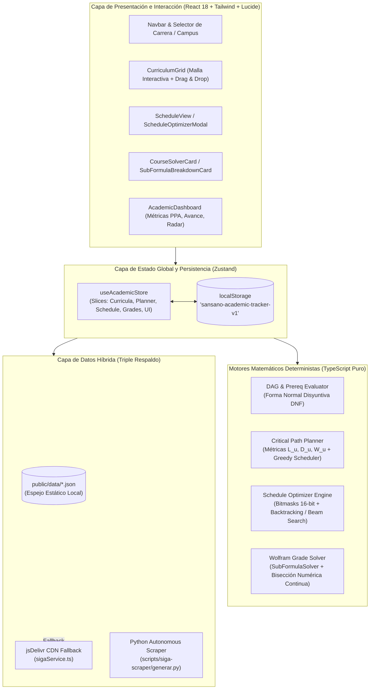
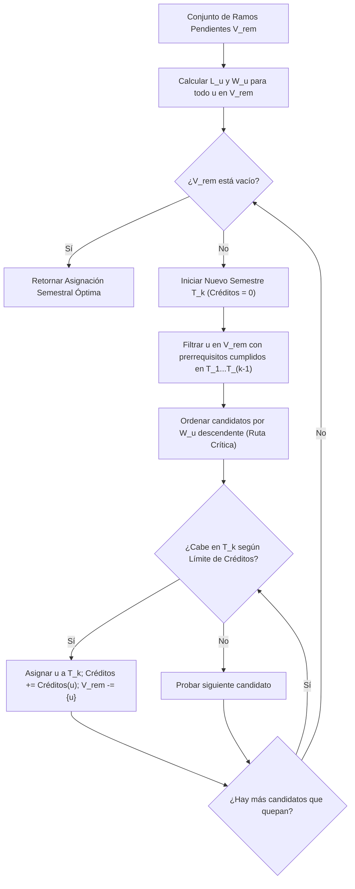
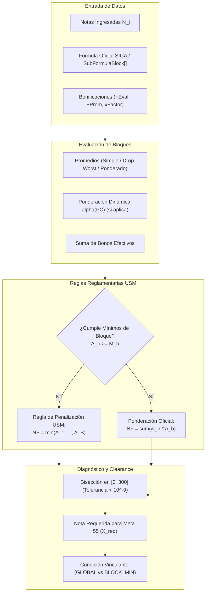
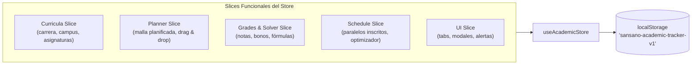
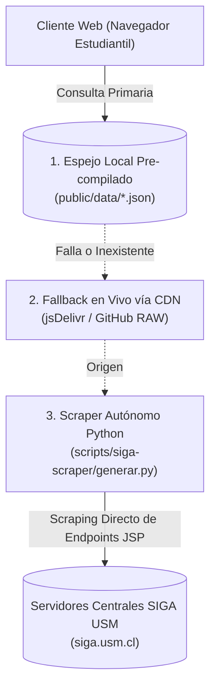

# Meta55 — USM Malla Curricular, Optimizador de Horario SIGA & Grade Solver

[](https://vitejs.dev/)
[](https://react.dev/)
[](https://www.typescriptlang.org/)
[](https://tailwindcss.com/)
[](https://github.com/pmndrs/zustand)
[](https://www.gnu.org/licenses/gpl-3.0)
[](https://meta55-dev.github.io/Malla-USM/)

> 🌐 **Plataforma Oficial en Producción:** [https://meta55-dev.github.io/Malla-USM/](https://meta55-dev.github.io/Malla-USM/)

**Meta55** es una plataforma web interactiva y determinista de código abierto diseñada para la comunidad universitaria de la **Universidad Técnica Federico Santa María (USM)** en todas sus sedes y campus (**Casa Central Valparaíso, Campus Santiago San Joaquín, Campus Santiago Vitacura, Sede Viña del Mar y Sede Concepción**).

La plataforma integra en una sola interfaz reactiva:
1. **Gestión Curricular y Ruta Crítica:** Grafo acíclico dirigido (DAG) con resolución de prerrequisitos lógicos (DNF), planificador de semestres por Drag & Drop y algoritmo voraz de egreso en tiempo mínimo.
2. **Optimizador Multi-Criterio de Horarios SIGA:** Motor de resolución combinatoria por máscaras de bits (bitmasks) que elimina colisiones, compacta ventanas y maximiza días libres a partir de la oferta real de paralelos docentes.
3. **Motor Algebraico "WolframAlpha USM" (`wolfram-solver`):** Solver de despeje analítico y bisección continua en $[0, 300]$ que resuelve la nota exacta para alcanzar la meta reglamentaria institucional ($NF \ge 55$), contemplando descarte de peores notas, ponderaciones no lineales continuas $\alpha(PC)$, regla oficial de penalización por muerte súbita ($NF = \min$) y simulador de certamen global y recuperativo.
4. **Arquitectura de Datos Híbrida de Triple Nivel:** Resiliencia de datos mediante almacenamiento estático local, fallback en vivo vía CDN y scraper autónomo en Python para los endpoints de `siga.usm.cl`.
5. **Privacidad Total (Zero-Backend):** Todos los estados, notas y planificaciones se procesan y persisten íntegramente en el navegador del usuario (`localStorage`), sin recolección de credenciales ni telemetría invasiva.

---

## Autores y Desarrolladores

Meta55 es concebido, desarrollado y mantenido por:

* **Joaquín D. Barrios** — GitHub: [@Jota216](https://github.com/Jota216)
* **Jose Astudillo** — GitHub: [@jastudilloi](https://github.com/jastudilloi)

🔗 **Acceso directo al software:** [https://meta55-dev.github.io/Malla-USM/](https://meta55-dev.github.io/Malla-USM/)

---

## Tabla de Contenidos

1. [Arquitectura Global del Sistema](#1-arquitectura-global-del-sistema)
2. [Estructura del Proyecto y Responsabilidades](#2-estructura-del-proyecto-y-responsabilidades)
3. [Malla Curricular, Grafo DAG y Planificador de Ruta Crítica](#3-malla-curricular-grafo-dag-y-planificador-de-ruta-crítica)
4. [Optimizador Multi-Criterio de Horarios Semestrales](#4-optimizador-multi-criterio-de-horarios-semestrales)
5. [Motor Algebraico "WolframAlpha USM" (wolfram-solver)](#5-motor-algebraico-wolframalpha-usm-wolfram-solver)
6. [Catálogo Oficial de Asignaturas y Presets Departamentales](#6-catálogo-oficial-de-asignaturas-y-presets-departamentales)
7. [Arquitectura de Estado y Tipado Canónico (Zustand)](#7-arquitectura-de-estado-y-tipado-canónico-zustand)
8. [Arquitectura de Datos Híbrida y Pipelines de Sincronización](#8-arquitectura-de-datos-híbrida-y-pipelines-de-sincronización)
9. [Diseño de Interfaz de Usuario y Experiencia (Frontend UI)](#9-diseño-de-interfaz-de-usuario-y-experiencia-frontend-ui)
10. [Garantía de Calidad y Pruebas Automatizadas (QA & Testing)](#10-garantía-de-calidad-y-pruebas-automatizadas-qa--testing)
11. [Guía de Desarrollo y Despliegue Continuo (CI/CD)](#11-guía-de-desarrollo-y-despliegue-continuo-cicd)
12. [Créditos y Licencia Open-Source](#12-créditos-y-licencia-open-source)

---

## 1. Arquitectura Global del Sistema

El sistema implementa una arquitectura desacoplada basada en capas unidireccionales:



---

## 2. Estructura del Proyecto y Responsabilidades

```
Malla-USM/
├── .github/workflows/
│   ├── deploy.yml                   # CI/CD: Despliegue automático a GitHub Pages en push a main
│   └── sync-data.yml                # Cron CI/CD: Sincronización semanal automática de datos SIGA
├── docs/
│   ├── CRITICAL_PATH_PLANNER_SPEC.md# Especificación formal del planificador de ruta crítica
│   ├── SCHEDULE_OPTIMIZER_SPEC.md   # Especificación algorítmica del optimizador de horarios
│   ├── SIGA_SCRAPER_ARCHITECTURE.md # Documentación técnica de endpoints JSP de siga.usm.cl
│   └── WOLFRAM_SOLVER_SPEC.md       # Especificación matemática del motor algebraico
├── public/data/                     # Datasets canónicos pre-compilados
│   ├── carreras.json                # Catálogo de 59 carreras y menciones por sede USM
│   ├── cursos.json                  # Catálogo general de asignaturas, créditos y departamentos
│   ├── planes.json                  # Mallas curriculares con prerrequisitos lógicos DNF
│   ├── prerequisitos.json           # Grafo canónico de correlatividades
│   ├── sigla_to_id.json             # Mapeo de siglas académicas a identificadores numéricos
│   ├── profesores.json              # Evaluaciones y reseñas docentes estudiantiles
│   ├── formulas_siga.json           # Fórmulas de evaluación extraídas de programas oficiales
│   ├── horarios/                    # Oferta horaria de asignaturas por campus y periodo
│   └── programas/                   # Metadatos curriculares y referencias a PDFs oficiales
├── scripts/
│   ├── extract-siga-formulas.mjs    # Parser AST/Regex para extraer fórmulas de evaluación
│   ├── sync-upstream-data.mjs       # Descarga e integración de datos desde AlvinIsCrack/horario-usm
│   └── siga-scraper/                # Scraper autónomo en Python para SIGA USM
│       ├── generar.py               # Orquestador del scraping de asignaturas y paralelos
│       └── requirements.txt         # Dependencias Python (requests, beautifulsoup4, urllib3)
├── src/
│   ├── components/
│   │   ├── AcademicDashboard.tsx    # Métricas de avance, créditos aprobados, PPA y gráficos
│   │   ├── CareerSelector.tsx       # Selector de campus (Valparaíso, San Joaquín, etc.) y carrera
│   │   ├── CourseModal.tsx          # Ficha técnica, prerrequisitos y paralelos de la asignatura
│   │   ├── CourseNode.tsx           # Nodo visual de ramo con estado, créditos y badges críticos
│   │   ├── CurriculumGrid.tsx       # Grilla semestral interactiva con soporte Drag & Drop
│   │   ├── ScheduleOptimizerModal.tsx# Panel modal de ponderaciones y ejecución del optimizador
│   │   ├── ScheduleView.tsx         # Grilla horaria semanal (Lunes a Sábado, Bloques 1 a 16)
│   │   └── WolframSolverCard.tsx    # Tarjeta de cálculo y simulación interactiva de notas
│   ├── context/                     # Contextos auxiliares de React
│   ├── hooks/                       # Hooks personalizados (useMediaQuery, useDebounce, etc.)
│   ├── services/
│   │   ├── criticalPathPlanner.ts   # Motor de cálculo de camino crítico y planificador de egreso
│   │   ├── scheduleOptimizer.ts     # Motor de optimización combinatoria horaria por bitmasks
│   │   └── sigaService.ts           # Servicio de datos con arquitectura de fallback por CDN
│   ├── store/
│   │   └── useAcademicStore.ts      # Store central Zustand con persistencia y slices funcionales
│   ├── types/
│   │   └── academic.ts              # Sistema canónico de tipos e interfaces TypeScript
│   ├── utils/
│   │   ├── formatters.ts            # Formateadores de texto, créditos y horarios
│   │   └── icsExport.ts             # Generador de calendarios .ics compatibles con RFC 5545
│   ├── wolfram-solver/              # Motor algebraico formal de calificaciones USM
│   │   ├── engine/
│   │   │   ├── gradeSolver.ts       # Motor lineal y rebalanceo algebraico de sliders
│   │   │   └── subFormulaSolver.ts  # Motor jerárquico, bisección, alpha(PC) y penalizaciones
│   │   ├── templates/
│   │   │   ├── defaultTemplates.ts  # Fábrica y auto-upgrade de configuraciones de ramo
│   │   │   ├── formulaPresets.ts    # Catálogo verificado de 41 fórmulas y 8 presets USM
│   │   │   └── inf292Template.ts    # Plantilla de referencia oficial para INF-292
│   │   └── tests/                   # Pruebas unitarias de los motores algebraicos
│   ├── tests/
│   │   └── qaIntegration.test.ts    # Suite integral de pruebas end-to-end y de integración
│   ├── App.tsx                      # Componente raíz y navegación por pestañas
│   └── main.tsx                     # Punto de entrada Vite/React
├── index.html                       # Entry point HTML5 con metadatos OpenGraph
├── package.json                     # Scripts y dependencias del proyecto
├── tailwind.config.js               # Configuración de diseño y paleta Zinc-950
├── tsconfig.json                    # Configuración estricta de compilador TypeScript
└── vite.config.ts                   # Configuración del empaquetador Vite
```

---

## 3. Malla Curricular, Grafo DAG y Planificador de Ruta Crítica

### 3.1 Grafo Acíclico Dirigido (DAG) y Prerrequisitos en DNF

El plan de estudios de cada carrera se modela formalmente como un Grafo Acíclico Dirigido $G = (V, E)$, donde los vértices $u \in V$ representan las asignaturas y las aristas dirigidas $(u, v) \in E$ indican que la asignatura $u$ es prerrequisito directo de la asignatura $v$.

Para capturar la flexibilidad de las mallas USM (donde un ramo puede desbloquearse mediante asignaturas alternativas o combinaciones de ellas), los requisitos se representan en **Forma Normal Disyuntiva (DNF — Disjunctive Normal Form)**:

$$\text{Requisito}(v) = \bigvee_{i=1}^{M} \left( \bigwedge_{u \in \mathcal{C}_i} u \text{ aprobado} \right)$$

Una asignatura $v$ se encuentra en estado **`DISPONIBLE` (Desbloqueado)** si y solo si:
1. No ha sido aprobada previamente: $v \notin \mathcal{A}$.
2. Se satisface al menos una de las cláusulas conjuntivas de prerrequisitos: $\exists i \in \{1, \dots, M\}$ tal que $\forall u \in \mathcal{C}_i, u \in \mathcal{A}$.
3. El estudiante cumple con el umbral mínimo de créditos aprobados exigidos por la carrera para dicho nivel: $\sum_{u \in \mathcal{A}} \text{Créditos}(u) \ge \text{CréditosMinimos}(v)$.

### 3.2 Métricas del Algoritmo de Ruta Crítica

El módulo `src/services/criticalPathPlanner.ts` analiza la topología completa de la malla para calcular tres métricas clave para cada asignatura $u$:

1. **Longitud del Camino Crítico ($L_u$):** Representa el número máximo de semestres encadenados estrictamente necesarios para llegar al egreso partiendo desde $u$:
   $$L_u = 1 + \max_{(u, v) \in E} \{ L_v \}, \quad \text{con } L_{\text{terminal}} = 1$$
2. **Grado de Desbloqueo ($D_u$):** Cantidad de asignaturas directas que dependen de la aprobación de $u$:
   $$D_u = |\{ v \in V \mid (u, v) \in E \}|$$
3. **Puntaje de Criticidad Global ($W_u$):** Priorización ponderada que balancea la profundidad del camino con el impacto inmediato:
   $$W_u = 10 \cdot L_u + D_u$$

#### Clasificación Visual de Asignaturas
- **`Crítico` ($L_u \ge 4$ o $W_u \ge 40$):** Asignatura cuello de botella. Reprobarla retrasa directamente la fecha estimada de titulación. Se resalta visualmente en la malla con un badge rojo ámbar. Para evitar obstrucciones durante la navegación rápida del usuario, su tooltip informativo incorpora un **retraso deliberado de 1.5 segundos**.
- **`Clave` ($L_u \ge 2$ o $D_u \ge 2$):** Asignatura con alto impacto en la apertura de ramos subsecuentes.

### 3.3 Algoritmo de Auto-Planificación de Salida Rápida (`planFastestGraduation`)

El planificador genera automáticamente una distribución semestral óptima de las asignaturas pendientes para minimizar el tiempo de graduación, respetando un límite configurativo de créditos por semestre (típicamente $30 \text{ SCT}$):



---

## 4. Optimizador Multi-Criterio de Horarios Semestrales

### 4.1 Representación Matemática por Máscaras de Bits (Bitmasks)

El motor `src/services/scheduleOptimizer.ts` implementa una representación ultracompacta del calendario semanal para evaluar millones de combinaciones de paralelos en milisegundos.

La semana académica se discretiza en **7 días** (Lunes a Domingo) y **16 bloques horarios** por día (Bloques 1 al 16, desde las 08:00 hasta las 21:00 hrs). El horario ocupado por un estudiante se modela como un vector de 7 enteros de 16 bits sin signo:

$$\mathbf{M} = \left[ M_{\text{lun}}, M_{\text{mar}}, M_{\text{mie}}, M_{\text{jue}}, M_{\text{vie}}, M_{\text{sab}}, M_{\text{dom}} \right] \in (\mathbb{U}_{16})^7$$

Donde el bit $k$-ésimo ($0 \le k \le 15$) vale $1$ si el bloque $k+1$ está ocupado, y $0$ si está libre.

#### Detección Instantánea de Colisiones (Clash Detection)
La superposición de dos paralelos $A$ y $B$ se evalúa mediante la operación binaria AND bit a bit a nivel de procesador:
$$\text{HayColisión}(A, B) \iff \exists d \in \{0, \dots, 6\} : (M_{A, d} \ \& \ M_{B, d}) \ne 0$$

### 4.2 Función Objetivo y Penalizaciones

Para una combinación de paralelos $\mathcal{S}$, el optimizador minimiza una función de costo multi-criterio ponderada por las preferencias del estudiante:

$$\min_{\mathcal{S}} \quad \mathcal{F}(\mathcal{S}) = w_{\text{clash}} \cdot \mathcal{P}_{\text{clash}}(\mathcal{S}) + w_{\text{window}} \cdot \mathcal{P}_{\text{window}}(\mathcal{S}) - w_{\text{free}} \cdot \mathcal{R}_{\text{free}}(\mathcal{S})$$

1. **Penalización por Topes ($\mathcal{P}_{\text{clash}}$):** Suma total de bits de colisión multiplicada por un factor disuasorio severo ($10{,}000$ puntos por cada bloque superpuesto):
   $$\mathcal{P}_{\text{clash}}(\mathcal{S}) = 10000 \cdot \sum_{d=0}^{6} \sum_{i < j} \text{popcount}(M_{i, d} \ \& \ M_{j, d})$$
2. **Penalización por Ventanas / Horas Muertas ($\mathcal{P}_{\text{window}}$):** Si en un día $d$ la primera clase ocurre en el bloque $b_{\min}$ y la última en $b_{\max}$, la cantidad de bloques libres intermedios (ventanas en campus) es:
   $$\text{Ventanas}(d) = \max\left(0, (b_{\max} - b_{\min} + 1) - \text{popcount}(M_d)\right)$$
   $$\mathcal{P}_{\text{window}}(\mathcal{S}) = 10 \cdot \sum_{d=0}^{6} \text{Ventanas}(d)$$
3. **Recompensa por Días Libres ($\mathcal{R}_{\text{free}}$):** Bonificación por cada día completo sin clases programadas:
   $$\mathcal{R}_{\text{free}}(\mathcal{S}) = 50 \cdot \sum_{d=0}^{6} \mathbb{I}(M_d == 0)$$

### 4.3 Estrategia Algorítmica Dual: Backtracking vs Beam Search

Para garantizar que la interfaz responda en menos de **50 ms** sin bloquear el hilo principal de React:

- **Espacios de Búsqueda Pequeños ($\prod |P_i| \le 200{,}000$ combinaciones):** Se ejecuta un algoritmo de **Backtracking Exhaustivo** con poda alfa-beta que encuentra el óptimo global exacto.
- **Espacios de Búsqueda Masivos ($\prod |P_i| > 200{,}000$ combinaciones):** Se activa automáticamente un **Beam Search Heurístico** con un ancho de haz configurado en $W = 600$. En cada nivel de ramo, se mantienen únicamente los 600 mejores estados parciales según la función $\mathcal{F}(\mathcal{S})$, convergiendo a soluciones casi óptimas en tiempo sub-lineal.

---

## 5. Motor Algebraico "WolframAlpha USM" (`wolfram-solver`)

El subsistema `src/wolfram-solver/` modela con rigor algebraico los reglamentos docentes institucionales de la USM.



### 5.1 Taxonomía de Bloques de Sub-fórmulas (`SubFormulaBlock`)

Cada asignatura divide su evaluación en $B$ bloques independientes $b \in \{1, \dots, B\}$, cada uno con su peso en la nota final $w_b^{\text{final}}$, un umbral mínimo $M_b$ (opcional), bonificaciones propias y evaluaciones $\mathcal{E}_b = \{e_1, \dots, e_N\}$.

#### 1. Promedio Simple (`simple_average`)
Sea $\mathcal{K}_b \subseteq \mathcal{E}_b$ el conjunto de notas rendidas y $\mathcal{U}_b$ las notas pendientes:
$$\bar{A}_b = \frac{1}{|\mathcal{K}_b|} \sum_{i \in \mathcal{K}_b} N_i$$

#### 2. Descarte de $k$ Peores Notas (`drop_worst`)
Utilizado en asignaturas con controles semanales (ej. $PCE$ en INF-292 con 7 controles y $k=1$, o controles en MAT-021/FIS-110).
- **Criterio de activación parcial:** Para evitar sesgar el promedio prematuramente, el descarte de las $k$ peores notas **solo se activa si el alumno ha rendido al menos $(|\mathcal{E}_b| - k)$ evaluaciones**:
  $$|\mathcal{K}_b| \ge |\mathcal{E}_b| - k$$
- Al activarse, se ordenan las notas conocidas $N_{(1)} \le N_{(2)} \le \dots \le N_{(|\mathcal{K}_b|)}$, se descartan las $k$ menores y se promedia el remanente:
  $$\bar{A}_b = \frac{1}{|\mathcal{K}_b| - k} \sum_{i = k + 1}^{|\mathcal{K}_b|} N_{(i)}$$

#### 3. Ponderación Arbitraria Intra-bloque (`weighted`)
Utilizado cuando las evaluaciones poseen porcentajes heterogéneos (ej. MAT-021: C1 20%, C2 25%, C3 30%):
$$\bar{A}_b = \frac{\sum_{i \in \mathcal{K}_b} w_i N_i}{\sum_{i \in \mathcal{K}_b} w_i}$$

### 5.2 Ponderación No Lineal Continua por Tramos: Parámetro $\alpha(PC)$

En cátedras avanzadas del Departamento de Informática (como **INF-245** e **INF-256**), la ponderación entre certámenes teóricos ($PC$) y tareas prácticas ($T$) es una función continua por tramos dependiente del rendimiento en certámenes:

$$NF = PC \cdot (1 - \alpha(PC)) + \alpha(PC) \cdot T$$

$$\alpha(PC) = \begin{cases} 
0 & \text{si } PC \le 30 \\ 
\frac{PC}{100} - 0.30 & \text{si } 30 < PC < 60 \\ 
0.30 & \text{si } PC \ge 60 
\end{cases}$$

```
   α(PC)
    0.30 ┼───────────────────────┈┈┈┈
         │                      /
         │                     /  Interpolación continua:
         │                    /   α(PC) = (PC / 100) - 0.30
       0 ┼──────────────────/────
         0                 30   60          100  PC
```

Si $PC \le 30$, $\alpha(PC) = 0 \implies NF = PC$, impidiendo reglamentariamente que notas altas en tareas compensen un déficit severo en certámenes teóricos. Además, el reglamento exige $T \ge 60$; si $T < 60$, se activa la regla de penalización por muerte súbita.

### 5.3 Sistema Integral de Bonificaciones

El motor formaliza cuatro canales de bonificación académica:

1. **`evalBonusPoints` (+Eval):** Puntos extra asignados a una evaluación específica. En un bloque con descarte de peores notas, su impacto se transfiere al promedio dividiéndose entre las notas efectivas:
   $$\Delta_{\text{eval}} = \frac{\text{evalBonusPoints}}{\max(1, |\mathcal{E}_b| - k)}$$
2. **`bonusPoints` (+Prom):** Puntos directos sumados al promedio final del bloque $b$:
   $$B_b = \text{bonusPoints} + \Delta_{\text{eval}}$$
   $$A_b = \min\left(100, \max\left(0, \bar{A}_b + B_b\right)\right)$$
3. **`finalGradeMultiplier` ($M$):** Factor multiplicativo sobre la nota final (ej. $1.05$ representa un $+5\%$).
4. **`finalGradeBonusPoints` ($B_{\text{global}}$):** Puntos aditivos netos a la nota de presentación:
   $$NF = \min\left(100, \max\left(0, NF_{\text{base}} \cdot M + B_{\text{global}}\right)\right)$$

### 5.4 Muerte Súbita y Regla de Penalización USM

La normativa general de la USM establece que los certámenes o laboratorios deben superar una nota de corte individual (comúnmente $M_b = 50$ o $M_b = 55$). Si un estudiante reprueba un bloque con requisito mínimo, la fórmula regular queda suspendida y la nota final queda truncada al mínimo de todos los bloques:

$$NF = \begin{cases} 
NF_{\text{fórmula}} & \text{si } \forall b \in \mathcal{B}_{\text{req}}: A_b \ge M_b \\ 
\min_{b \in \mathcal{B}} \{ A_b \} & \text{si } \exists b \in \mathcal{B}_{\text{req}}: A_b < M_b 
\end{cases}$$

### 5.5 Bisección Continua en $[0, 300]$ y Diagnóstico Académico

Para hallar la calificación uniforme $X$ que el estudiante debe obtener en las evaluaciones pendientes para asegurar $NF(X) \ge 55$, el solver ejecuta una **Búsqueda Binaria Numérica** en el intervalo $[0, 300]$ a lo largo de 40 iteraciones:

$$\text{Error Absoluto Máximo} = \frac{300 - 0}{2^{40}} \approx 2.73 \times 10^{-10} \text{ puntos}$$

El techo extendido en $300$ permite diagnosticar con exactitud matemática escenarios de inviabilidad académica:
- **`APPROVED` ($X \le 0$):** Aprobado garantizado con nota 0 en lo restante.
- **`ON_TRACK` ($0 < X \le 80$):** En curso regular; meta factible.
- **`IN_DANGER` ($80 < X \le 100$):** En peligro académico; requiere rendimiento sobresaliente.
- **`REQUIRES_PERFECT` ($X > 100$):** Exigencia extrema o matemáticamente inalcanzable en escala ordinaria.
- **`FAILED`:** Asignatura finalizada con $NF < 55$ o reprobada por condición de muerte súbita.

---

## 6. Catálogo Oficial de Asignaturas y Presets Departamentales

### 6.1 Catálogo Oficial Verificado desde SIGA USM (`OFFICIAL_FORMULAS_MAP`)

Meta55 integra **41 asignaturas de alta demanda** transcritas y validadas directamente desde sus programas oficiales descargados de `siga.usm.cl`:

| Sigla | Nombre de Asignatura | Expresión Algebraica Verificada | Mínimos y Reglas Especiales | ID PDF SIGA |
| :--- | :--- | :--- | :--- | :--- |
| **IWI-131** | Programación | $0.50 \cdot PC + 0.20 \cdot PQ + 0.20 \cdot PT + 0.10 \cdot PF$ | $PC \ge 55$; si no, $NF = PC$. | `118019706.pdf` |
| **MAT-021** | Matemática I | $0.75 \cdot PC + 0.25 \cdot PQ$ | $PC$: C1 20%, C2 25%, C3 30%. $PQ$: 5 mejores de 6. | `118019806.pdf` |
| **MAT-022** | Matemática II | $0.75 \cdot PC + 0.25 \cdot PQ$ | $PC$: C1 20%, C2 25%, C3 30%. $PQ$: 5 mejores de 6. | `118019906.pdf` |
| **MAT-023** | Matemática III | $0.75 \cdot PC + 0.25 \cdot PQ$ | $PC$: C1 20%, C2 25%, C3 30%. $PQ$: 5 mejores de 6. | `118020006.pdf` |
| **MAT-024** | Matemática IV | $0.75 \cdot PC + 0.25 \cdot PQ$ | $PC$: C1 20%, C2 25%, C3 30%. $PQ$: 5 mejores de 6. | `118020106.pdf` |
| **FIS-100** | Introducción a la Física | $0.70 \cdot PC + 0.20 \cdot PQ + 0.10 \cdot PT$ | 3 certámenes (70%), controles y tareas. | `121002606.pdf` |
| **FIS-110** | Física General I | $0.75 \cdot PC + 0.17 \cdot PQ + 0.08 \cdot PT$ | $PC \ge 50$. $PQ$: elimina 1. $PT$: elimina 2. | `121002706.pdf` |
| **FIS-120** | Física General II | $0.75 \cdot PC + 0.17 \cdot PQ + 0.08 \cdot PT$ | $PC \ge 50$. $PQ$: elimina 1. $PT$: elimina 2. | `121002806.pdf` |
| **FIS-130** | Física General III | $0.75 \cdot PC + 0.17 \cdot PQ + 0.08 \cdot PT$ | $PC \ge 50$. $PQ$: elimina 1. $PT$: elimina 2. | `121003106.pdf` |
| **FIS-140** | Física General IV | $0.75 \cdot PC + 0.17 \cdot PQ + 0.08 \cdot PT$ | $PC \ge 50$. $PQ$: elimina 1. $PT$: elimina 2. | `121003406.pdf` |
| **QUI-010** | Química y Sociedad | $0.75 \cdot PC + 0.25 \cdot PQ$ | 3 certámenes (75%) + Controles periódicos (25%). | `118020206.pdf` |
| **HRW-132** | Inglés I | $0.50 \cdot PC + 0.30 \cdot PO + 0.20 \cdot PQ$ | Escritos (50%), orales (30%), quizes (20%). | `118020306.pdf` |
| **HRW-133** | Inglés II | $0.50 \cdot PC + 0.30 \cdot PO + 0.20 \cdot PQ$ | Escritos (50%), orales (30%), quizes (20%). | `118020406.pdf` |
| **INF-134** | Estructuras de Datos | $0.60 \cdot PC + 0.25 \cdot PT + 0.15 \cdot PQ$ | $PC \ge 50$. Tareas (25%), controles (15%, elimina 1). | `118056606.pdf` |
| **INF-152** | Estructuras Discretas | $0.65 \cdot PC + 0.20 \cdot PT + 0.15 \cdot PQ$ | $PC \ge 50$. 3 certámenes, tareas y controles. | `118056706.pdf` |
| **INF-260** | Teoría de Autómatas | $0.70 \cdot PC + 0.20 \cdot PT + 0.10 \cdot PQ$ | $PC \ge 50$. 3 certámenes (70%), tareas y quizes. | `118056806.pdf` |
| **INF-253** | Lenguajes de Programación| $0.60 \cdot PC + 0.25 \cdot PT + 0.15 \cdot PQ$ | $PC \ge 50$. Tareas de programación (25%). | `118056906.pdf` |
| **INF-155** | Informática Teórica | $0.70 \cdot PC + 0.20 \cdot PT + 0.10 \cdot PQ$ | $PC \ge 50$. Certámenes teóricos y guías. | `118057006.pdf` |
| **INF-239** | Sistemas Operativos | $0.50 \cdot PC + 0.30 \cdot PL + 0.20 \cdot PQ$ | $PC \ge 50$, $PL \ge 50$. Laboratorios C/Linux. | `118057106.pdf` |
| **INF-245** | Arq. Sistemas Software | $PC \cdot (1 - \alpha) + \alpha \cdot PT$ | **Peso Dinámico $\alpha(PC)$**. $PT \ge 60$. | `118057205.pdf` |
| **INF-280** | Estadística Computacional | $0.65 \cdot PC + 0.10 \cdot PQ + 0.25 \cdot PL$ | $PC \ge 50$. Laboratorio en R/Python. | `118057306.pdf` |
| **INF-270** | Redes de Computadores | $0.50 \cdot PC + 0.30 \cdot PL + 0.20 \cdot PQ$ | $PC \ge 50$, $PL \ge 50$. Experiencias de red. | `118057406.pdf` |
| **INF-236** | Análisis y Diseño Software| $0.40 \cdot PC + 0.60 \cdot PP$ | $PC \ge 50$, $PP \ge 55$. Proyecto semestral. | `118057606.pdf` |
| **INF-246** | Bases de Datos | $0.60 \cdot PC + 0.25 \cdot PP + 0.15 \cdot PQ$ | $PC \ge 50$. Proyecto SQL/NoSQL (25%). | `118057706.pdf` |
| **INF-276** | Sistemas Distribuidos | $0.50 \cdot PC + 0.35 \cdot PL + 0.15 \cdot PQ$ | $PC \ge 50$, $PL \ge 50$. Laboratorios distribuidos. | `118057806.pdf` |
| **INF-221** | Algoritmos y Complejidad | $0.70 \cdot PC + 0.20 \cdot PT + 0.10 \cdot PQ$ | $PC \ge 50$. Certámenes analíticos. | `118057906.pdf` |
| **INF-225** | Inteligencia Artificial | $0.55 \cdot PC + 0.35 \cdot PT + 0.10 \cdot PQ$ | $PC \ge 50$. Proyectos de ML y búsqueda. | `118058006.pdf` |
| **INF-292** | Optimización | $0.10 \cdot PCE + 0.45 \cdot PC + 0.45 \cdot PP$ | $PCE \ge 50$, $PC \ge 50$, $PP \ge 50$. Elimina 1 CE. | `118058106.pdf` |
| **INF-256** | Ingeniería de Software | $PC \cdot (1 - \alpha) + \alpha \cdot PL$ | **Peso Dinámico $\alpha(PC)$**. $PL \ge 60$. | `118057506.pdf` |
| **ICN-270** | Gestión de Empresas | $0.60 \cdot PC + 0.25 \cdot PT + 0.15 \cdot PQ$ | 3 certámenes (60%) y casos empresariales. | `118058206.pdf` |
| **INF-285** | Computación Científica | $0.60 \cdot PC + 0.30 \cdot PT + 0.10 \cdot PQ$ | $PC \ge 50$. Tareas numéricas computacionales. | `118058306.pdf` |
| **INF-293** | Modelos Estocásticos | $0.70 \cdot PC + 0.30 \cdot PT$ | $PC \ge 50$. Cadenas de Markov y colas. | `118058406.pdf` |
| **INF-322** | Seguridad Informática | $0.50 \cdot PC + 0.30 \cdot PL + 0.20 \cdot PQ$ | $PC \ge 50$, $PL \ge 50$. Criptografía y exploits. | `118058506.pdf` |
| **INF-343** | Sistemas de Información | $0.50 \cdot PC + 0.35 \cdot PP + 0.15 \cdot PQ$ | $PC \ge 50$, $PP \ge 55$. Proyecto ERP/BI. | `118058606.pdf` |
| **INF-295** | Finanzas de Empresas | $0.60 \cdot PC + 0.25 \cdot PT + 0.15 \cdot PQ$ | Evaluación económica y certámenes. | `118058706.pdf` |
| **INF-266** | Compiladores | $0.50 \cdot PC + 0.40 \cdot PP + 0.10 \cdot PQ$ | $PC \ge 50$, $PP \ge 50$. Proyecto analizador. | `118058806.pdf` |
| **TEL-101** | Redes de Acceso | $1.00 \cdot PC$ | 5 controles periódicos (elimina 1 menor). | `118058906.pdf` |
| **INF-360** | Taller de Desarrollo SW | $0.40 \cdot PC + 0.60 \cdot PP$ | $PP \ge 60$. Proyecto de software cliente real. | `118059006.pdf` |
| **INF-228** | Computación Paralela | $0.50 \cdot PC + 0.40 \cdot PL + 0.10 \cdot PQ$ | $PC \ge 50$, $PL \ge 50$. OpenMP/MPI/CUDA. | `118059106.pdf` |
| **INF-309** | Memoria de Titulación I | $0.60 \cdot HI + 0.40 \cdot EF$ | Hitos de avance semestral e informe final. | `118059206.pdf` |
| **INF-310** | Memoria de Titulación II| $0.60 \cdot IT + 0.40 \cdot ET$ | Informe de titulación (60%) y Defensa (40%). | `118059306.pdf` |

### 6.2 Presets Departamentales Rápidos (`USM_FORMULA_PRESETS`)

Para asignaturas electivas o no catalogadas, Meta55 dispone de 8 plantillas seleccionables con un solo clic:
1. **`usm_inf_alpha` (Informática Ponderación Dinámica $\alpha$):** $NF = PC(1 - \alpha) + \alpha PT$, con $\alpha \in [0, 0.30]$, umbrales $30$ y $60$, requisito $PT \ge 60$.
2. **`usm_mat` (Depto. Matemática USM):** $NP = 0.20 \cdot C_1 + 0.25 \cdot C_2 + 0.30 \cdot C_3 + 0.25 \cdot PQ$. Bloque $PQ$ de 6 controles descartando la nota menor.
3. **`usm_fis` (Depto. Física USM):** $NF = 0.75 \cdot PC + 0.17 \cdot PQ + 0.08 \cdot PT$, con $PC \ge 50$. Controles descarta $1$ peor; tareas descarta $2$ peores.
4. **`usm_inf_lab` (Ramo con Laboratorio):** $NF = 0.50 \cdot PC + 0.30 \cdot PL + 0.20 \cdot PQ$, con requisitos $PC \ge 50$ y $PL \ge 50$.
5. **`usm_inf_teorico` (Especialidad / Informática):** $NF = 0.60 \cdot PC + 0.25 \cdot PT + 0.15 \cdot PQ$, con $PC \ge 50$.
6. **`usm_standard` (Estándar General USM 70/30):** $NF = 0.70 \cdot PC + 0.30 \cdot PT$, con $PC \ge 50$.
7. **`usm_project` (Taller o Proyecto):** $NF = 0.50 \cdot HP + 0.30 \cdot PF + 0.20 \cdot EA$ (Hitos, Prototipo y Exposiciones).
8. **`usm_controles_only` (Evaluación Continua 100%):** $NF = 1.00 \cdot PC$ (5 controles con descarte de la nota más baja).

---

## 7. Arquitectura de Estado y Tipado Canónico (Zustand)

Toda la reactividad del cliente se gestiona mediante un único store central (`src/store/useAcademicStore.ts`) respaldado por el middleware `persist` de Zustand:



### Tipos Canónicos Fundamentales (`src/types/academic.ts`)
- **`Course`:** Sigla, nombre, departamento, créditos USM y créditos SCT.
- **`CourseFinalFormula`:** Estructura jerárquica con `SubFormulaBlock[]`, bonificaciones globales y regla de penalización.
- **`SubFormulaBlock`:** Tipo de agregación (`simple_average`, `drop_worst`, `weighted`), porcentaje sobre nota final, umbral mínimo de aprobación y lista de `SubFormulaEvaluation`.
- **`ScheduleEvent`:** Día, bloques inicio/término, sala, tipo de cátedra/ayudantía y paralelo docente.

---

## 8. Arquitectura de Datos Híbrida y Pipelines de Sincronización

Meta55 garantiza continuidad operacional absoluta mediante una arquitectura de tres niveles de respaldo:



1. **Nivel 1 (Espejo Estático Local):** Los archivos JSON en `public/data/` son servidos directamente por el bundle de Vite con latencia nula y sin dependencias de red externas.
2. **Nivel 2 (Fallback CDN en `sigaService.ts`):** Si un archivo JSON específico no se encuentra disponible localmente, el servicio consulta de forma transparente el espejo CDN de GitHub (`cdn.jsdelivr.net/gh/meta55-dev/Malla-USM@main/public/data/...`).
3. **Nivel 3 (Scraper Autónomo en Python):** El directorio `scripts/siga-scraper/` contiene la implementación completa para consultar directamente los formularios JSP de `siga.usm.cl` (`acceso.do`, `paralelos.jsp`, etc.), generando los conjuntos de datos en caso de contingencias mayores en las fuentes upstream.

---

## 9. Diseño de Interfaz de Usuario y Experiencia (Frontend UI)

La interfaz de usuario ha sido concebida siguiendo los más estrictos principios de diseño para el trabajo académico intensivo:
- **Tema Oscuro `zinc-950` Nativo:** Contraste tipográfico optimizado para reducir la fatiga visual durante sesiones prolongadas de estudio nocturno.
- **Iconografía Profesional:** Uso exclusivo de [Lucide Icons](https://lucide.dev/), erradicando emojis invasivos que comprometan la sobriedad técnica del software.
- **Drag & Drop Interactivo con Estabilidad de Layout:** Reordenamiento ágil de asignaturas entre semestres con detección de ciclos en tiempo real.
- **Tooltips No Invasivos (1.5s Delay):** Las fichas informativas de criticidad (`Crítico` / `Clave`) no saltan de manera accidental al mover el cursor por la malla curricular.
- **Exportación Estándar `.ics`:** Descarga de horarios semestrales en formato iCalendar estándar (RFC 5545), integrable directamente con Google Calendar, Apple Calendar y Microsoft Outlook.

---

## 10. Garantía de Calidad y Pruebas Automatizadas (QA & Testing)

El repositorio cuenta con una rigurosa batería de pruebas automatizadas con [Vitest](https://vitest.dev/):

| Suite de Pruebas | Ubicación | Ámbito y Casos de Borde Validados |
| :--- | :--- | :--- |
| **Integración End-to-End** | `src/tests/qaIntegration.test.ts` | 6 suites completas: aciclicidad del DAG, detección de colisiones de horario por bitmasks, progresión de créditos, resiliencia ante datos corruptos en `localStorage` y flujos de usuario integrados. |
| **Motor de Sub-fórmulas** | `src/wolfram-solver/tests/subFormulaSolver.test.ts` | Descarte parcial de peores notas en series incompletas, activación de regla de penalización USM ($NF = \min$), discriminación de condición vinculante (`BLOCK_MIN` vs `GLOBAL`) y bisección en $[0, 300]$. |
| **Motor Lineal y Grafo** | `src/wolfram-solver/tests/gradeSolver.test.ts` | Normalización de pesos heterogéneos, reemplazo de peor certamen por examen recuperativo, rebalanceo de sliders interactivos en tiempo real y verificación de 59 asignaturas de ICI 2014. |

Para ejecutar todas las pruebas unitarias y de integración:
```bash
npm run test
```

---

## 11. Guía de Desarrollo y Despliegue Continuo (CI/CD)

### Requisitos Previos
* **Node.js:** Versión 18.0 o superior
* **npm:** Versión 9.0 o superior
* **Python (Opcional, solo para ejecución manual del scraper SIGA):** Versión 3.9 o superior

### Instalación y Puesta en Marcha Local
```bash
# 1. Clonar el repositorio
git clone https://github.com/meta55-dev/Malla-USM.git
cd Malla-USM

# 2. Instalar dependencias de Node.js
npm install

# 3. Iniciar servidor de desarrollo local
npm run dev
```

### Scripts Disponibles en `package.json`
* `npm run dev`: Inicia el servidor de desarrollo Vite con Hot Module Replacement (HMR).
* `npm run build`: Compila y optimiza la aplicación para producción en la carpeta `dist/`.
* `npm run preview`: Previsualiza localmente el paquete de producción generado.
* `npm run test`: Ejecuta la suite de pruebas unitarias y de integración con Vitest.
* `npm run sync:data`: Ejecuta el pipeline Node.js de sincronización con datos upstream.
* `npm run extract:formulas`: Ejecuta el extractor analítico de fórmulas desde programas SIGA.

### Flujo de Despliegue Automatizado (CI/CD)
- **`.github/workflows/deploy.yml`:** Ante cada `push` a la rama `main`, ejecuta los tests unitarios, compila el bundle estático mediante Vite y despliega automáticamente la versión a [GitHub Pages](https://meta55-dev.github.io/Malla-USM/).
- **`.github/workflows/sync-data.yml`:** Flujo programado (cron semanal) que sincroniza de manera automática las actualizaciones de oferta de cursos y horarios.

---

## 12. Créditos y Licencia Open-Source

* **Autores y Desarrolladores de Meta55:**
  * **Joaquín D. Barrios** ([@Jota216](https://github.com/Jota216))
  * **Jose Astudillo** ([@jastudilloi](https://github.com/jastudilloi))
* **Atribución de Datos y Agradecimientos:**
  * Los datasets de asignaturas, planes de estudio, horarios de paralelos y la lógica base del scraper de SIGA provienen del proyecto open-source [**horario-usm**](https://github.com/AlvinIsCrack/horario-usm), creado y mantenido por [**@AlvinIsCrack**](https://github.com/AlvinIsCrack).
* **Licencia:**
  * Este proyecto se distribuye bajo la licencia **GNU General Public License v3.0 (GPLv3)**. Consulta el archivo `LICENSE` para mayores detalles sobre derechos de uso, copia, modificación y redistribución.
