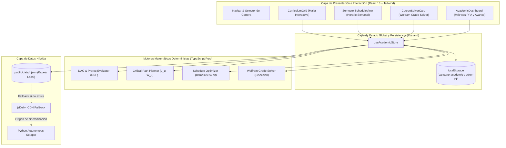

# Meta55 — USM Malla Curricular, Optimizador de Horario SIGA & Grade Solver

[](https://vitejs.dev/)
[](https://react.dev/)
[](https://www.typescriptlang.org/)
[](https://tailwindcss.com/)
[](https://github.com/pmndrs/zustand)
[](https://opensource.org/licenses/MIT)
[](https://meta55-dev.github.io/Malla-USM/)

> 🌐 **Plataforma Oficial en Producción:** [https://meta55-dev.github.io/Malla-USM/](https://meta55-dev.github.io/Malla-USM/)

**Meta55** es una plataforma web interactiva y determinista de código abierto diseñada para la comunidad universitaria de la **Universidad Técnica Federico Santa María (USM)** en todas sus sedes y campus (**Casa Central Valparaíso, Campus Santiago San Joaquín, Campus Santiago Vitacura, Sede Viña del Mar y Sede Concepción**).

---

## Capacidades Principales

1. **Gestión Curricular y Ruta Crítica:** Grafo acíclico dirigido (DAG) con resolución de prerrequisitos lógicos disyuntivos (DNF), planificación interactiva y algoritmo voraz de graduación en tiempo mínimo con balance de créditos.
2. **Optimizador Multi-Criterio de Horarios SIGA:** Motor combinatorio por máscaras de bits (hasta 24 bits) que previene colisiones, compacta ventanas y maximiza días libres considerando régimen diurno y vespertino.
3. **Motor Algebraico "Wolfram USM" (`wolfram-solver`):** Solver analítico y numérico con bisección continua en $[0, 300]$ que despeja la nota requerida para la meta institucional ($NF \ge 55$), contemplando descarte de peores notas, ponderaciones no lineales continuas $\alpha(PC)$, regla oficial de penalización por muerte súbita ($NF = \min$) y simulador de certamen global.
4. **Arquitectura de Datos de Triple Nivel:** Resiliencia absoluta mediante espejo estático local, fallback en vivo vía CDN y scraper autónomo en Python para catálogos de `siga.usm.cl`.
5. **Privacidad Total (Zero-Backend):** Todos los estados, notas y planificaciones se procesan y persisten íntegramente en el navegador del usuario (`localStorage`).

---

## Autores y Desarrolladores

Meta55 es concebido, desarrollado y mantenido por:

* **Joaquín D. Barrios** — GitHub: [@Jota216](https://github.com/Jota216)
* **Jose Astudillo** — GitHub: [@jastudilloi](https://github.com/jastudilloi)

---

## Arquitectura Global del Sistema



---

## Estructura del Repositorio

El código se organiza modularmente separando presentación, dominios matemáticos y servicios de datos:

```
Malla-USM/
├── .github/workflows/
│   ├── deploy.yml                   # CI/CD: Pruebas y despliegue a GitHub Pages en main
│   ├── pr-check.yml                 # CI/CD: Validación obligatoria de tests y build en PRs
│   └── sync-data.yml                # Cron CI/CD: Sincronización periódica y PR automática
├── docs/                            # Documentación técnica y especificaciones formales
│   ├── CRITICAL_PATH_PLANNER_SPEC.md# Especificación del grafo DAG y ruta crítica
│   ├── SCHEDULE_OPTIMIZER_SPEC.md   # Modelo de máscaras de 24 bits y optimización
│   ├── SIGA_SCRAPER_ARCHITECTURE.md # Documentación de endpoints y scraping SIGA
│   └── WOLFRAM_SOLVER_SPEC.md       # Modelos algebraicos, alpha(PC) y catálogo de 41 asignaturas
├── public/data/                     # Catálogos canónicos JSON (carreras, ramos, horarios)
├── scripts/                         # Pipelines de sincronización y extracción de datos
├── src/
│   ├── curricula/                   # Planes de estudio, requisitos DNF y planificador
│   │   ├── planner/                 # Algoritmo de ruta crítica y compactación retrógrada
│   │   ├── prerequisites/           # Validador de aciclicidad y desbloqueo de grafos
│   │   └── services/                # Servicio de catálogos y horarios SIGA
│   ├── frontend/                    # Componentes UI (React 18 + Tailwind)
│   │   └── components/
│   │       ├── curriculum/          # Grilla semestral, nodos y modales de ramo
│   │       ├── dashboard/           # Métricas de avance, radar y estadísticas
│   │       ├── schedule/            # Vista semanal de horarios y ScheduleGridTable
│   │       └── solver/              # CourseSolverCard y GlobalExamSimulatorPanel
│   ├── shared/                      # Tipos globales TypeScript y Zustand store
│   │   ├── store/                   # useAcademicStore con persistencia blindada
│   │   └── types/                   # Interfaces canónicas académicas
│   └── wolfram-solver/              # Motor algebraico de calificaciones USM
│       ├── engine/                  # SubFormulaSolver, bisección continua y rebalanceo
│       └── templates/               # Fórmulas oficiales SIGA y presets departamentales
├── package.json                     # Scripts y dependencias
├── tsconfig.json                    # Configuración estricta de TypeScript
└── vite.config.ts                   # Configuración del empaquetador Vite
```

---

## Especificaciones Técnicas Detalladas

Para una revisión matemática y algorítmica profunda, consulta las especificaciones en el directorio `docs/`:

| Módulo | Documento de Especificación | Resumen Técnico |
| :--- | :--- | :--- |
| **Ruta Crítica** | [`CRITICAL_PATH_PLANNER_SPEC.md`](docs/CRITICAL_PATH_PLANNER_SPEC.md) | Topología DAG, métricas de camino crítico ($L_u, D_u, W_u$), DNF y compactación retrógrada. |
| **Optimizador de Horario** | [`SCHEDULE_OPTIMIZER_SPEC.md`](docs/SCHEDULE_OPTIMIZER_SPEC.md) | Vectores de 24 bits, conteo popcount $O(1)$, cuantificación de ventanas y Beam Search ($W=60$). |
| **Motor Wolfram-Solver** | [`WOLFRAM_SOLVER_SPEC.md`](docs/WOLFRAM_SOLVER_SPEC.md) | Ponderación no lineal $\alpha(PC)$, regla de penalización $NF = \min$, bisección en $[0, 300]$ y tabla de 41 asignaturas. |
| **Scraper SIGA** | [`SIGA_SCRAPER_ARCHITECTURE.md`](docs/SIGA_SCRAPER_ARCHITECTURE.md) | Arquitectura de contingencia, formularios JSP de `siga.usm.cl` y modelos de datos. |

---

## Puesta en Marcha y Desarrollo Local

### Requisitos Previos
* **Node.js:** Versión 18.0 o superior
* **npm:** Versión 9.0 o superior

### Instalación
```bash
# 1. Clonar el repositorio
git clone https://github.com/meta55-dev/Malla-USM.git
cd Malla-USM

# 2. Instalar dependencias
npm install

# 3. Iniciar servidor de desarrollo Vite con Hot Reload
npm run dev
```

### Comandos de Calidad y Construcción
* `npm run dev`: Inicia el entorno local de desarrollo.
* `npm run test`: Ejecuta las 5 suites de pruebas unitarias y de integración mediante `tsx`.
* `npm run build`: Compila TypeScript en modo estricto y empaqueta la aplicación con Vite para producción.
* `npm run preview`: Previsualiza localmente el paquete generado en `dist/`.
* `npm run sync:data`: Sincroniza datos de carreras y asignaturas desde el repositorio upstream.
* `npm run extract:formulas`: Ejecuta el extractor automatizado de fórmulas desde programas de estudio.

---

## Garantía de Calidad (QA & CI/CD)

El repositorio exige la ejecución exitosa de pruebas antes de cualquier integración a la rama principal:

1. **SubFormulaSolver Suite:** Valida descarte de peores notas, penalización USM ($NF = \min$), bisección en $[0, 300]$ y vinculación de restricciones.
2. **GradeSolver Suite:** Normalización de ponderadores, sustitución por examen recuperativo y rebalanceo interactivo.
3. **ScheduleOptimizer Suite:** Verificación de máscaras de 24 bits, detección de colisiones y desempeño de Beam Search ($< 50 \text{ ms}$).
4. **CriticalPathPlanner Suite:** Planificación topológica de egreso rápido, ordenamiento voraz y compactación sin semestres huérfanos.
5. **QA Integration Suite:** Persistencia en `localStorage`, compatibilidad de esquemas, exportación e importación `.json` y ciclo de vida de desinscripción segura.

---

## Créditos y Licencia Open-Source

* **Autores de Meta55:**
  * **Joaquín D. Barrios** ([@Jota216](https://github.com/Jota216))
  * **Jose Astudillo** ([@jastudilloi](https://github.com/jastudilloi))
* **Atribución de Datos:**
  * Los catálogos base provienen del proyecto open-source [**horario-usm**](https://github.com/AlvinIsCrack/horario-usm) de [**@AlvinIsCrack**](https://github.com/AlvinIsCrack).
* **Licencia:**
  * Este software se distribuye bajo la licencia **MIT License**. Consulta el archivo [`LICENSE`](LICENSE) para más información.
