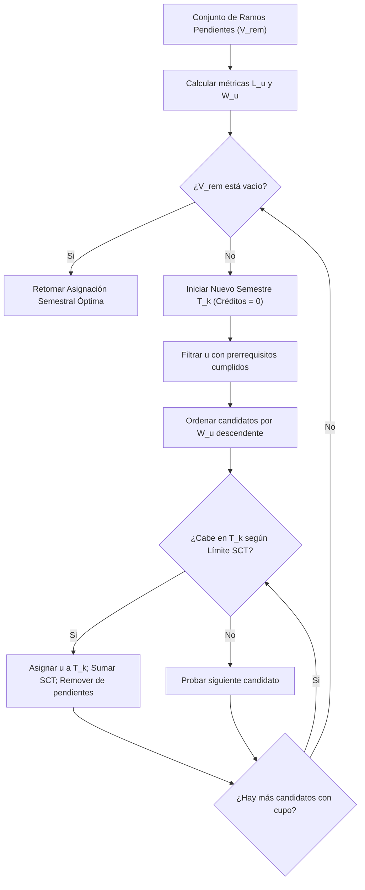

# Especificación Formal: Grafo DAG y Planificador de Ruta Crítica (Meta55)

Este documento detalla la formulación matemática, topología de grafos y algoritmos de planificación académica implementados en el motor de malla curricular de **Meta55** ([`src/curricula/planner/criticalPathPlanner.ts`](file:///c:/Users/jjjj/Documents/Malla-USM/src/curricula/planner/criticalPathPlanner.ts)).

---

## 1. Grafo Acíclico Dirigido (DAG) y Prerrequisitos en DNF

El plan de estudios de cada carrera se modela formalmente como un Grafo Acíclico Dirigido $G = (V, E)$, donde:
- Los vértices $u \in V$ representan las asignaturas curriculares.
- Las aristas dirigidas $(u, v) \in E$ indican que la asignatura $u$ es prerrequisito directo de la asignatura $v$.

### Forma Normal Disyuntiva (DNF — Disjunctive Normal Form)
Para capturar la flexibilidad de las mallas USM (donde un ramo puede desbloquearse mediante asignaturas alternativas o combinaciones de ellas), los requisitos se representan en **Forma Normal Disyuntiva (DNF)**:

$$\text{Requisito}(v) = \bigvee_{i=1}^{M} \left( \bigwedge_{u \in \mathcal{C}_i} u \text{ aprobado} \right)$$

Una asignatura $v$ se encuentra en estado **`DISPONIBLE` (Desbloqueado)** si y solo si:
1. No ha sido aprobada previamente: $v \notin \mathcal{A}$.
2. Se satisface al menos una de las cláusulas conjuntivas de prerrequisitos:
   $$\exists i \in \{1, \dots, M\} \quad \text{tal que} \quad \forall u \in \mathcal{C}_i, \ u \in \mathcal{A}$$
3. El estudiante cumple con el umbral mínimo de créditos aprobados exigidos por la carrera para dicho nivel:
   $$\sum_{u \in \mathcal{A}} \text{Créditos}(u) \ge \text{CréditosMinimos}(v)$$

---

## 2. Métricas del Algoritmo de Ruta Crítica

El módulo analiza la topología completa de la malla para calcular tres métricas clave para cada asignatura $u$:

1. **Longitud del Camino Crítico ($L_u$):**
   Representa el número máximo de semestres encadenados estrictamente necesarios para llegar al egreso partiendo desde $u$:
   $$L_u = 1 + \max_{(u, v) \in E} \{ L_v \}, \quad \text{con } L_{\text{terminal}} = 1$$

2. **Grado de Desbloqueo ($D_u$):**
   Cantidad de asignaturas directas que dependen de la aprobación de $u$:
   $$D_u = |\{ v \in V \mid (u, v) \in E \}|$$

3. **Puntaje de Criticidad Global ($W_u$):**
   Priorización ponderada que balancea la profundidad del camino con el impacto inmediato:
   $$W_u = 10 \cdot L_u + D_u$$

### Clasificación Visual de Asignaturas
- **`Crítico` ($L_u \ge 4$ o $W_u \ge 40$):** Asignatura cuello de botella. Reprobarla retrasa directamente la fecha estimada de titulación. Se resalta visualmente en la malla con un badge rojo ámbar. Para evitar obstrucciones durante la navegación rápida del usuario, su tooltip informativo incorpora un **retraso deliberado de 1.5 segundos**.
- **`Clave` ($L_u \ge 2$ o $D_u \ge 2$):** Asignatura con alto impacto en la apertura de ramos subsecuentes.

---

## 3. Algoritmo de Auto-Planificación de Salida Rápida (`planFastestGraduation`)

El planificador genera automáticamente una distribución semestral óptima de las asignaturas pendientes para minimizar el tiempo de graduación, respetando un límite configurable de créditos por semestre (típicamente $30 \text{ SCT}$):

### Pase de Compactación Retrógrada (Backward Compaction)
Tras la asignación voraz, se ejecuta una pasada de compactación en orden temporal descendente:
- Evalúa si asignaturas ubicadas en semestres tardíos pueden ser adelantadas a semestres anteriores con holgura de créditos disponible.
- Elimina semestres solitarios o de carga marginal al final de la carrera, comprimiendo la malla al menor número matemáticamente factible de períodos.
