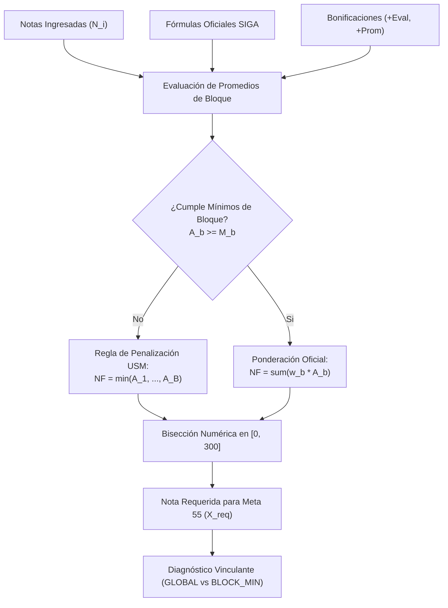

# Especificación Matemática: Motor Wolfram-Solver y Reglamentos USM (Meta55)

Este documento detalla la formulación matemática y el modelado algebraico de calificaciones implementados en el subsistema [`src/wolfram-solver/`](file:///c:/Users/jjjj/Documents/Malla-USM/src/wolfram-solver/).

---

## 1. Arquitectura de Evaluación por Bloques

---

## 2. Taxonomía de Agregación de Evaluaciones

Cada asignatura divide su evaluación en $B$ bloques independientes $b \in \{1, \dots, B\}$, cada uno con su peso en la nota final $w_b^{\text{final}}$, un umbral mínimo $M_b$ (opcional), bonificaciones propias y evaluaciones $\mathcal{E}_b = \{e_1, \dots, e_N\}$.

### 1. Promedio Simple (`simple_average`)
$$\bar{A}_b = \frac{1}{|\mathcal{K}_b|} \sum_{i \in \mathcal{K}_b} N_i$$

### 2. Descarte de $k$ Peores Notas (`drop_worst`)
Utilizado en asignaturas con controles periódicos (ej. INF-292 con 7 controles y $k=1$, o controles en MAT-021/FIS-110).
- **Criterio de activación parcial:** Para evitar sesgar el promedio prematuramente, el descarte de las $k$ peores notas **solo se activa si el alumno ha rendido al menos $(|\mathcal{E}_b| - k)$ evaluaciones**:
  $$|\mathcal{K}_b| \ge |\mathcal{E}_b| - k$$
- Al activarse, se ordenan las notas conocidas $N_{(1)} \le N_{(2)} \le \dots \le N_{(|\mathcal{K}_b|)}$, se descartan las $k$ menores y se promedia el remanente:
  $$\bar{A}_b = \frac{1}{|\mathcal{K}_b| - k} \sum_{i = k + 1}^{|\mathcal{K}_b|} N_{(i)}$$

### 3. Ponderación Arbitraria Intra-bloque (`weighted`)
Utilizado cuando las evaluaciones poseen porcentajes heterogéneos (ej. MAT-021: C1 20%, C2 25%, C3 30%):
$$\bar{A}_b = \frac{\sum_{i \in \mathcal{K}_b} w_i N_i}{\sum_{i \in \mathcal{K}_b} w_i}$$

---

## 3. Ponderación No Lineal Continua: Parámetro $\alpha(PC)$

En asignaturas del Departamento de Informática (como **INF-245** e **INF-256**), la ponderación entre certámenes teóricos ($PC$) y tareas prácticas ($T$) es una función continua por tramos dependiente del rendimiento en certámenes:

$$NF = PC \cdot (1 - \alpha(PC)) + \alpha(PC) \cdot T$$

$$\alpha(PC) = \begin{cases} 
0 & \text{si } PC \le 30 \\ 
\frac{PC}{100} - 0.30 & \text{si } 30 < PC < 60 \\ 
0.30 & \text{si } PC \ge 60 
\end{cases}$$

Si $PC \le 30$, $\alpha(PC) = 0 \implies NF = PC$, impidiendo reglamentariamente que notas altas en tareas compensen un déficit severo en certámenes teóricos. Además, el reglamento exige $T \ge 60$; si $T < 60$, se activa la regla de penalización por muerte súbita.

---

## 4. Muerte Súbita y Regla de Penalización USM

La normativa general de la USM establece que los certámenes o laboratorios deben superar una nota de corte individual (comúnmente $M_b = 50$ o $M_b = 55$). Si un estudiante reprueba un bloque con requisito mínimo, la fórmula regular queda suspendida y la nota final queda truncada al mínimo de todos los bloques:

$$NF = \begin{cases} 
NF_{\text{fórmula}} & \text{si } \forall b \in \mathcal{B}_{\text{req}}: A_b \ge M_b \\ 
\min_{b \in \mathcal{B}} \{ A_b \} & \text{si } \exists b \in \mathcal{B}_{\text{req}}: A_b < M_b 
\end{cases}$$

---

## 5. Bisección Continua en $[0, 300]$ y Diagnóstico Académico

Para hallar la calificación uniforme $X$ que el estudiante debe obtener en las evaluaciones pendientes para asegurar $NF(X) \ge 55$, el solver ejecuta una **búsqueda binaria numérica** en el intervalo $[0, 300]$ a lo largo de 40 iteraciones con un error absoluto $< 2.73 \times 10^{-10}$ puntos.

### Clasificación Diagnóstica
- **`APPROVED` ($X \le 0$):** Aprobado garantizado matemáticamente con nota 0 en lo restante.
- **`ON_TRACK` ($0 < X \le 80$):** En curso regular; meta factible.
- **`IN_DANGER` ($80 < X \le 100$):** En peligro académico; requiere rendimiento sobresaliente.
- **`REQUIRES_PERFECT` ($X > 100$):** Exigencia extrema o matemáticamente inalcanzable en escala ordinaria.
- **`FAILED`:** Asignatura reprobada irremediablemente o por condición de muerte súbita.

---

## 6. Catálogo Oficial Verificado de 41 Asignaturas USM

| Sigla | Nombre de Asignatura | Expresión Algebraica Verificada | Mínimos y Reglas Especiales | ID PDF SIGA |
| :--- | :--- | :--- | :--- | :--- |
| **IWI-131** | Programación | $0.50 \cdot PC + 0.20 \cdot PQ + 0.20 \cdot PT + 0.10 \cdot PF$ | $PC \ge 55$; si no, $NF = PC$. | `118019706.pdf` |
| **MAT-021** | Matemática I | $0.75 \cdot PC + 0.25 \cdot PQ$ | $PC$: C1 20%, C2 25%, C3 30%. $PQ$: 5 mejores de 6. | `118019806.pdf` |
| **MAT-022** | Matemática II | $0.75 \cdot PC + 0.25 \cdot PQ$ | $PC$: C1 20%, C2 25%, C3 30%. $PQ$: 5 mejores de 6. | `118019906.pdf` |
| **MAT-023** | Matemática III | $0.75 \cdot PC + 0.25 \cdot PQ$ | $PC$: C1 20%, C2 25%, C3 30%. $PQ$: 5 mejores de 6. | `118020006.pdf` |
| **MAT-024** | Matemática IV | $0.75 \cdot PC + 0.25 \cdot PQ$ | $PC$: C1 20%, C2 25%, C3 30%. $PQ$: 5 mejores de 6. | `118020106.pdf` |
| **FIS-100** | Introducción a la Física | $0.70 \cdot PC + 0.20 \cdot PQ + 0.10 \cdot PT$ | 3 certámenes (70%), controles y tareas. | `121002606.pdf` |
| **FIS-110** | Física General I | $0.75 \cdot PC + 0.17 \cdot PQ + 0.08 \cdot PT$ | $PC \ge 50$. $PQ$: elimina 1. $PT$: elimina 2. | `121002706.pdf` |
| **FIS-120** | Física General II | $0.75 \cdot PC + 0.17 \cdot PQ + 0.08 \cdot PT$ | $PC \ge 50$. $PQ$: elimina 1. $PT$: elimina 2. | `121002806.pdf` |
| **FIS-130** | Física General III | $0.75 \cdot PC + 0.17 \cdot PQ + 0.08 \cdot PT$ | $PC \ge 50$. $PQ$: elimina 1. $PT$: elimina 2. | `121003106.pdf` |
| **FIS-140** | Física General IV | $0.75 \cdot PC + 0.17 \cdot PQ + 0.08 \cdot PT$ | $PC \ge 50$. $PQ$: elimina 1. $PT$: elimina 2. | `121003406.pdf` |
| **QUI-010** | Química y Sociedad | $0.75 \cdot PC + 0.25 \cdot PQ$ | 3 certámenes (75%) + Controles periódicos (25%). | `118020206.pdf` |
| **HRW-132** | Inglés I | $0.50 \cdot PC + 0.30 \cdot PO + 0.20 \cdot PQ$ | Escritos (50%), orales (30%), quizes (20%). | `118020306.pdf` |
| **HRW-133** | Inglés II | $0.50 \cdot PC + 0.30 \cdot PO + 0.20 \cdot PQ$ | Escritos (50%), orales (30%), quizes (20%). | `118020406.pdf` |
| **INF-134** | Estructuras de Datos | $0.60 \cdot PC + 0.25 \cdot PT + 0.15 \cdot PQ$ | $PC \ge 50$. Tareas (25%), controles (15%, elimina 1). | `118056606.pdf` |
| **INF-152** | Estructuras Discretas | $0.65 \cdot PC + 0.20 \cdot PT + 0.15 \cdot PQ$ | $PC \ge 50$. 3 certámenes, tareas y controles. | `118056706.pdf` |
| **INF-260** | Teoría de Autómatas | $0.70 \cdot PC + 0.20 \cdot PT + 0.10 \cdot PQ$ | $PC \ge 50$. 3 certámenes (70%), tareas y quizes. | `118056806.pdf` |
| **INF-253** | Lenguajes de Programación| $0.60 \cdot PC + 0.25 \cdot PT + 0.15 \cdot PQ$ | $PC \ge 50$. Tareas de programación (25%). | `118056906.pdf` |
| **INF-155** | Informática Teórica | $0.70 \cdot PC + 0.20 \cdot PT + 0.10 \cdot PQ$ | $PC \ge 50$. Certámenes teóricos y guías. | `118057006.pdf` |
| **INF-239** | Sistemas Operativos | $0.50 \cdot PC + 0.30 \cdot PL + 0.20 \cdot PQ$ | $PC \ge 50$, $PL \ge 50$. Laboratorios C/Linux. | `118057106.pdf` |
| **INF-245** | Arq. Sistemas Software | $PC \cdot (1 - \alpha) + \alpha \cdot PT$ | **Peso Dinámico $\alpha(PC)$**. $PT \ge 60$. | `118057205.pdf` |
| **INF-280** | Estadística Computacional | $0.65 \cdot PC + 0.10 \cdot PQ + 0.25 \cdot PL$ | $PC \ge 50$. Laboratorio en R/Python. | `118057306.pdf` |
| **INF-270** | Redes de Computadores | $0.50 \cdot PC + 0.30 \cdot PL + 0.20 \cdot PQ$ | $PC \ge 50$, $PL \ge 50$. Experiencias de red. | `118057406.pdf` |
| **INF-236** | Análisis y Diseño Software| $0.40 \cdot PC + 0.60 \cdot PP$ | $PC \ge 50$, $PP \ge 55$. Proyecto semestral. | `118057606.pdf` |
| **INF-246** | Bases de Datos | $0.60 \cdot PC + 0.25 \cdot PP + 0.15 \cdot PQ$ | $PC \ge 50$. Proyecto SQL/NoSQL (25%). | `118057706.pdf` |
| **INF-276** | Sistemas Distribuidos | $0.50 \cdot PC + 0.35 \cdot PL + 0.15 \cdot PQ$ | $PC \ge 50$, $PL \ge 50$. Laboratorios distribuidos. | `118057806.pdf` |
| **INF-221** | Algoritmos y Complejidad | $0.70 \cdot PC + 0.20 \cdot PT + 0.10 \cdot PQ$ | $PC \ge 50$. Certámenes analíticos. | `118057906.pdf` |
| **INF-225** | Inteligencia Artificial | $0.55 \cdot PC + 0.35 \cdot PT + 0.10 \cdot PQ$ | $PC \ge 50$. Proyectos de ML y búsqueda. | `118058006.pdf` |
| **INF-292** | Optimización | $0.10 \cdot PCE + 0.45 \cdot PC + 0.45 \cdot PP$ | $PCE \ge 50$, $PC \ge 50$, $PP \ge 50$. Elimina 1 CE. | `118058106.pdf` |
| **INF-256** | Ingeniería de Software | $PC \cdot (1 - \alpha) + \alpha \cdot PL$ | **Peso Dinámico $\alpha(PC)$**. $PL \ge 60$. | `118057506.pdf` |
| **ICN-270** | Gestión de Empresas | $0.60 \cdot PC + 0.25 \cdot PT + 0.15 \cdot PQ$ | 3 certámenes (60%) y casos empresariales. | `118058206.pdf` |
| **INF-285** | Computación Científica | $0.60 \cdot PC + 0.30 \cdot PT + 0.10 \cdot PQ$ | $PC \ge 50$. Tareas numéricas computacionales. | `118058306.pdf` |
| **INF-293** | Modelos Estocásticos | $0.70 \cdot PC + 0.30 \cdot PT$ | $PC \ge 50$. Cadenas de Markov y colas. | `118058406.pdf` |
| **INF-322** | Seguridad Informática | $0.50 \cdot PC + 0.30 \cdot PL + 0.20 \cdot PQ$ | $PC \ge 50$, $PL \ge 50$. Criptografía y exploits. | `118058506.pdf` |
| **INF-343** | Sistemas de Información | $0.50 \cdot PC + 0.35 \cdot PP + 0.15 \cdot PQ$ | $PC \ge 50$, $PP \ge 55$. Proyecto ERP/BI. | `118058606.pdf` |
| **INF-295** | Finanzas de Empresas | $0.60 \cdot PC + 0.25 \cdot PT + 0.15 \cdot PQ$ | Evaluación económica y certámenes. | `118058706.pdf` |
| **INF-266** | Compiladores | $0.50 \cdot PC + 0.40 \cdot PP + 0.10 \cdot PQ$ | $PC \ge 50$, $PP \ge 50$. Proyecto analizador. | `118058806.pdf` |
| **TEL-101** | Redes de Acceso | $1.00 \cdot PC$ | 5 controles periódicos (elimina 1 menor). | `118058906.pdf` |
| **INF-360** | Taller de Desarrollo SW | $0.40 \cdot PC + 0.60 \cdot PP$ | $PP \ge 60$. Proyecto de software cliente real. | `118059006.pdf` |
| **INF-228** | Computación Paralela | $0.50 \cdot PC + 0.40 \cdot PL + 0.10 \cdot PQ$ | $PC \ge 50$, $PL \ge 50$. OpenMP/MPI/CUDA. | `118059106.pdf` |
| **INF-309** | Memoria de Titulación I | $0.60 \cdot HI + 0.40 \cdot EF$ | Hitos de avance semestral e informe final. | `118059206.pdf` |
| **INF-310** | Memoria de Titulación II| $0.60 \cdot IT + 0.40 \cdot ET$ | Informe de titulación (60%) y Defensa (40%). | `118059306.pdf` |
